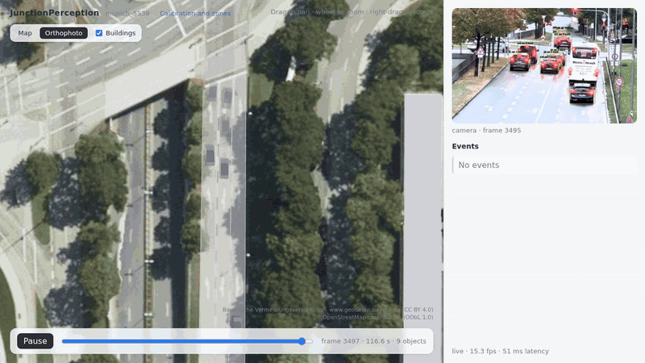
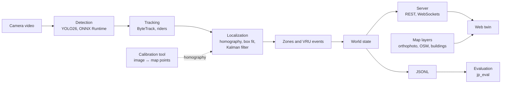

# JunctionPerception

[](https://github.com/moavazpour/JunctionPerception/actions/workflows/ci.yml)

A live digital twin of a signalized intersection from the video of a single fixed camera, with a
focus on vulnerable road users (VRUs): pedestrians, cyclists and motorcyclists.



*The twin of a custom scene: road users from the camera video (right) placed on the orthophoto of
the intersection. Map data: Bayerische Vermessungsverwaltung – www.geodaten.bayern.de (CC BY 4.0),
© OpenStreetMap contributors (ODbL 1.0).*

## Problem and approach

Traffic cameras at intersections are rarely calibrated, yet safety analysis needs road users in
metric map coordinates: where pedestrians cross, how fast vehicles approach them, how close they
come. JunctionPerception turns any fixed-camera video into such a top-down world state:

1. **Calibrate** the camera against a map once, by clicking corresponding points in the camera
   image and on an orthophoto; the tool fits an image-to-ground homography and reports the error of
   every point in metres.
2. **Detect** road users in every frame with a COCO-pretrained YOLO26 model (ONNX Runtime, CUDA).
3. **Track** them in the image with ByteTrack; a person on a bicycle or motorcycle becomes one rider.
4. **Localize** each track on the ground plane: the bottom centre of the box through the
   homography, corrected to the footprint centre by fitting a class-sized box with the camera
   model. This is ground-plane (bird's-eye view) localization, not 3D detection.
5. **Filter** positions with a Kalman filter whose measurement noise follows the camera geometry,
   giving speed, heading and their uncertainty.
6. **Detect events**: a VRU on a crosswalk, and VRU–vehicle conflicts from the predicted gap
   between footprints.
7. **Stream** the world state to a web twin: a top-down Three.js view on the map, with the camera
   image and the event list.

## Architecture



The C++23 core is split into modules (`core`, `io`, `calibration`, `detection`, `tracking`,
`localization`, `vru`, `sources`, `server`, `evaluation`, `benchmark`, `twin`); the frontend is
TypeScript with Vite and Three.js. Details, coordinate frames and the world-state schema:
[docs/architecture.md](docs/architecture.md).

## Key features

- **Calibration in the browser** – image and orthophoto side by side, fit and check points,
  residuals in metres, outlier rejection, camera position and height, zone editor with
  crosswalk suggestions from OpenStreetMap.
- **Map context** – orthophoto, OpenStreetMap roads and LoD2 building models in the scene's
  world frame (local east-north-up at a geographic anchor), with attribution.
- **Physically based uncertainty** – image noise of the box bottom propagated through the
  homography (anisotropic, growing with the square of the range along the viewing ray), outlier
  gating for swapped or merged boxes, per-class motion models.
- **VRU events** – crosswalk occupancy and conflicts predicted from footprint gaps, only from
  velocities that are known well enough; the state of the vehicle (moving, stopped, starting)
  is reported. Scenes calibrated from control points limit events to the region where positions
  are validated and resolved finely enough; objects elsewhere are tracked and drawn faded.
- **Three sources, one pipeline** – `live` (camera video), `oracle` (benchmark labels) and
  `replay` (recorded JSONL) produce the same world state.
- **Benchmark evaluation** – detection, localization, motion, tracking (MOTA, IDF1) and conflict
  metrics against LiDAR labels, with ablations.

## Custom mode and benchmark mode

**Custom mode** is the product: any intersection video plus a scene created with the calibration
tool (`scenes/<name>/`: `scene.yaml`, control points, homography, zones). The scene
`scenes/munich_5538` is an example, filmed from a pedestrian bridge.

**Benchmark mode** runs on the TUMTraf Intersection
dataset (R02, sequences S1–S4, south cameras of the S110 gantry). Its calibration and 3D labels
measure the localization quantitatively and drive the `oracle` source. Dataset-specific code is
limited to the `benchmark` module and the evaluation.

## Results

Live pipeline against the south-LiDAR labels of TUMTraf Intersection R02, S1–S4, both south
cameras (4320 frames); matching gates 2 m for vehicles, 1 m for VRUs. Errors: mean / median /
P90.

| Contact-to-centre correction | Precision | Recall | Position error (m) | Speed error, median (m/s) | IDF1 |
|---|---|---|---|---|---|
| box fit (default) | 0.444 | 0.546 | 0.82 / 0.67 / 1.73 | 0.06 | 0.459 |
| ray offset | 0.424 | 0.521 | 0.91 / 0.76 / 1.75 | 0.06 | 0.433 |
| none | 0.370 | 0.452 | 0.89 / 0.78 / 1.69 | 0.10 | 0.382 |

| Condition (box fit) | Recall | Position error (m) |
|---|---|---|
| day (S1–S3) | 0.643 | 0.79 / 0.62 / 1.71 |
| night, rain (S4) | 0.144 | 1.33 / 1.30 / 1.80 |

<p>
  
  
</p>

Pedestrians are localized with a median error of 0.47 m. Recall falls beyond 40 m from the camera
and at night; trucks and trailers, labelled as two boxes but seen as one vehicle, are mostly
missed by the 2 m gate. The method, all tables and their interpretation:
[docs/evaluation.md](docs/evaluation.md).

On the [reference hardware](docs/hardware.md) the live pipeline takes about 28 ms per 1920×1080
frame (YOLO26s at 1280 px on CUDA).

## Quick start

Everything builds and runs inside a Docker development image, so a host needs Docker (with the
NVIDIA Container Toolkit for GPU inference) and Python only for the helper tools.

**Set up and build**

```bash
git clone https://github.com/moavazpour/JunctionPerception.git && cd JunctionPerception
scripts/setup_server.sh                                     # development image (GPU if available)
scripts/in_docker.sh scripts/build_and_test.sh all release  # C++ and frontend: build, lint, test
```

**Export the detector** (needs the `ultralytics` and `onnx` Python packages)

```bash
python tools/export_yolo26.py --variant yolo26s --imgsz 1280   # -> models/yolo26s_1280.onnx
```

**Start the console.** The site manager serves the web console and runs one twin server per active
camera; a site is one intersection (`scenes/<name>/`) with up to four cameras. The first start runs
the scene of `configs/server.yaml`:

```bash
JP_SERVER_ADDRESS=<LAN address> JP_DATA_ROOT=<video folder> scripts/run_manager.sh
```

The console is at `http://<LAN address>:8080/`, bound to that address only. It shows every
intersection with the live images and counters of its cameras, one 3D twin of all sites at their
real positions (top-down or tilted; overlapping cameras merged), and the
system page with start, stop and restart of the backend, host and GPU load, and the logs of every
server.

**Add and calibrate an intersection.** In the console, *New site* asks for the centre of the
intersection (latitude, longitude; the map layers are downloaded for 200 m around it) and its one to
four cameras: for each, the arm it watches and its source (a video uploaded from the browser or
already below the data root, an RTSP/HTTP stream, or a recording; the image size is read from it).
Then calibrate each camera in *Calibration* (it starts the camera and playback if needed): click at
least
eight points in the camera image and the same points on the aerial image, check the residuals, set
the camera position if the points cannot constrain it, draw the zones, save and apply. Details:
[docs/map-data.md](docs/map-data.md). A single scene can still be served without the console:
`scripts/run_server.sh --scene scenes/<name> --mode live --input <video>`.

**Google imagery (optional).** With a key of the Google Map Tiles API in `GOOGLE_MAPS_API_KEY`
(`DEPLOY_GOOGLE_MAPS_API_KEY` in `deploy.env`), the map tool takes the aerial image from Google
satellite tiles and adds a Google road map layer; without it, the Bavarian orthophoto is used.

**Process a video offline**

```bash
scripts/in_docker.sh build/release/src/apps/jp_run --source /data/<video> --scene scenes/<name> \
    --world-jsonl outputs/run/world.jsonl --overlay outputs/run/overlay.mp4 --bev outputs/run/bev.mp4
```

**Run the benchmark.** Put the TUMTraf Intersection R02 sequences (`a9_dataset_r02_s01` …
`s04`) and their south-camera videos into the data root, then:

```bash
JP_DATA_ROOT=<dataset root> JP_PYTHON=<python with matplotlib> scripts/run_benchmark.sh <run>
```

This writes `outputs/<run>/eval/` with a report per variant, a summary and figures.

## Repository layout

| Path | Content |
|---|---|
| `include/jp/`, `src/` | C++ modules, one folder each; command-line programs in `src/apps/` |
| `tests/` | C++ unit tests (GoogleTest) and the shared world-state example |
| `web/` | Twin and calibration tool (TypeScript, Vite, Three.js) with unit tests (Vitest) |
| `configs/` | Pipeline, classes, server and evaluation settings |
| `scenes/` | Scenes: calibration, zones and geographic anchor |
| `tools/` | Detector export, map data preparation, evaluation figures (Python) |
| `scripts/` | Development image, build and test, server, benchmark, deployment |
| `docker/` | Development image |
| `docs/` | Architecture, evaluation, map data, reference hardware |

## Configuration

| File | Content |
|---|---|
| `configs/pipeline.yaml` | Detector model and thresholds, tracking, localization noise model, event rules |
| `configs/classes.yaml` | Twin classes with footprint sizes, VRU flag, mapping of COCO and TUMTraf labels |
| `configs/server.yaml` | Address, port, video stream, playback, startup scene |
| `configs/evaluation.yaml` | Matching gates and metric settings of `jp_eval` |

Programs: `jp_server` (twin server), `jp_run` (offline processing and debug videos),
`jp_calibrate` (benchmark calibration), `jp_eval` (evaluation); each lists its options with
`--help`.

## Limitations

- The detector is COCO-pretrained and not fine-tuned for roadside viewpoints; it has no classes
  for vans, trailers or emergency vehicles, and it degrades strongly at night and in rain.
- Localization assumes a planar ground and uses the bottom of the 2D box as ground contact; it is
  not 3D detection. Errors grow with the distance from the camera.
- Custom videos are assumed free of lens distortion.
- Object footprints have a fixed size per class.
- One camera; occlusions are not reasoned about, and objects that merge in the image can swap
  identities.
- Accuracy depends on the quality of the manual calibration, and the region where events are
  reliable depends on the camera's viewpoint.

## Roadmap

- Fine-tuning the detector on roadside data.
- Monocular 3D detection.
- Automatic calibration from aerial imagery or the ground plane, with drift detection for moving
  masts.
- Tilted or free 3D view and a photorealistic 3D map backdrop.
- Fusion of several cameras.
- RTSP live streams.
- A decision layer on top of the twin.

## Acknowledgements and citations

- **TUMTraf Intersection dataset** – W. Zimmer, C. Creß, H. T. Nguyen, A. C. Knoll: *TUMTraf
  Intersection Dataset: All You Need for Urban 3D Camera-LiDAR Roadside Perception*, IEEE ITSC
  2023.
- **Ultralytics YOLO26** – Ultralytics, [docs.ultralytics.com](https://docs.ultralytics.com).
- **ByteTrack** – Y. Zhang et al.: *ByteTrack: Multi-Object Tracking by Associating Every
  Detection Box*, ECCV 2022.
- **Three.js** – [threejs.org](https://threejs.org); **ONNX Runtime**, **OpenCV**, **PROJ**,
  **Crow**, **Eigen** and the other libraries listed in `vcpkg.json` and `web/package.json`.
- **Map data** – orthophoto (DOP20) and LoD2 building models: Bayerische Vermessungsverwaltung –
  [www.geodaten.bayern.de](https://www.geodaten.bayern.de), CC BY 4.0; roads and crossings:
  © OpenStreetMap contributors, ODbL 1.0. Map data is downloaded per scene and not part of this
  repository.

## License

MIT – see [LICENSE](LICENSE). Datasets, model weights and map data keep their own licenses.
