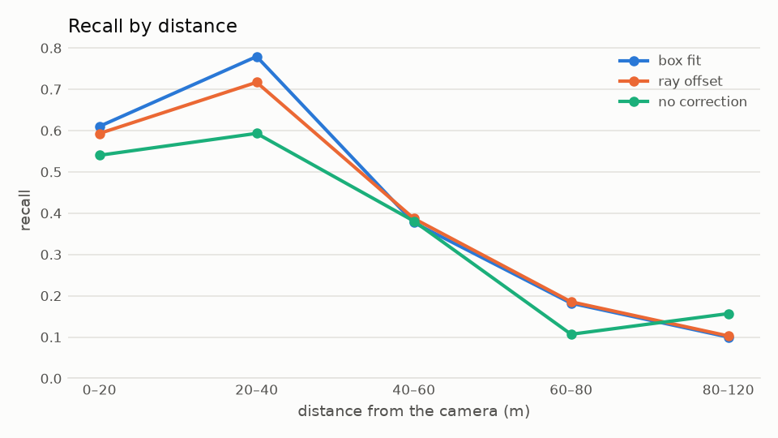
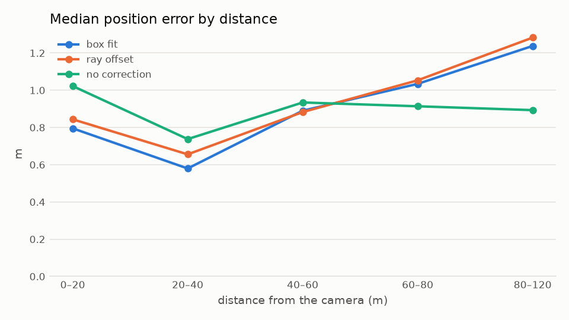

# JunctionPerception

[](https://github.com/moavazpour/JunctionPerception/actions/workflows/ci.yml)

A live bird's-eye-view (BEV) digital twin of an intersection from the video of one or more fixed
cameras: every road user — vehicles, pedestrians, cyclists — in metric map coordinates, with its
speed, heading and their uncertainty, one identity across all cameras of the site.

## Pipeline

```text
video → detection → tracking → ground-plane localization → heading      (C++, one server per camera)
      → time alignment → association and fusion → global IDs           (Python, site world model)
      → site state → BEV                                                (browser, drawing only)
```

1. **Calibrate** each camera against the map once, by clicking corresponding points in the camera
   image and on an aerial image; the tool fits an image-to-ground homography and reports the
   error of every point in metres.
2. **Detect** road users in every frame (YOLO26 or a keypoint model giving the four bottom corners
   of each 3D box; ONNX Runtime, CUDA) and **track** them in the image (ByteTrack; a person on a
   bicycle or motorcycle becomes one rider).
3. **Localize** each track on the ground plane with a Kalman filter whose measurement noise follows
   the camera geometry: position, velocity, heading with its source, and their uncertainty.
4. **Fuse** the cameras of a site in the backend world model: observations are aligned on one
   site clock, associated by gates on their covariances, fused, and given global IDs that survive
   camera ID switches and short occlusions. Without a common clock the site runs visibly unfused.
5. **Show** the site state in the BEV console: map, camera coverage, zones, traffic lights and
   road users exactly as the backend reports them, next to the camera videos.

Architecture, contracts and ownership: [docs/architecture.md](docs/architecture.md); rules for
contributors and coding agents: [AGENTS.md](AGENTS.md); decisions: [docs/adr/](docs/adr/).

## Custom mode and benchmark mode

**Custom mode** is the product: any intersection video plus a site created in the console
(`scenes/<name>/`: `scene.yaml`, cameras with their calibration, zones). The scene
`scenes/munich_5538` is an example, filmed from a pedestrian bridge.

**Benchmark mode** runs on the TUMTraf Intersection dataset (R02, sequences S1–S4, south cameras
of the S110 gantry). Its calibration and 3D labels measure the localization and the site world
model quantitatively and drive the `oracle` source. Dataset-specific code is limited to the
`benchmark` module, the evaluation and `tools/eval_fusion.py`.

## Results

### What the twin shows, without the dataset's calibration

Each road user the twin draws with a heading, in each frame, compared with the TUMTraf LiDAR
labels (R02, south1 on s01 and south2 on s03, day, 1 315 frames). The cameras are calibrated only
with points picked on the map in the console; camera position and height are estimated from them,
and the detector is not trained on TUMTraf. Road users without a heading are left out.

| Distance from the camera | Within 2 m of a label | Position error, median |
|---|---|---|
| 0–40 m | 85 % | 0.54 m |
| 40–60 m | 25 % (another 50 % 2–5 m off) | 0.57 m |
| all | 52 % (62 % where the dataset has labels) | 0.55 m (P90 1.13 m) |

Heading error: median 3.8°. Road users the twin shows where nothing is labelled (17 %) were checked
on the video frames: the 16 largest tracks are all real road users the labels leave out; no false
detection was found among them. Beyond 40 m the error comes from the calibration (south2's
height is estimated 0.9 m too high). Limits: two day sequences, nearly all objects from south2;
the labels are aligned to the map with 0.85 m RMS, which is part of every error.
[Details](docs/evaluation.md#road-users-the-twin-shows-with-a-heading-2026-11-06).

### Benchmark mode

Live pipeline against the south-LiDAR labels of TUMTraf Intersection R02, S1–S4, both south
cameras (4320 frames); matching gates 2 m for vehicles, 1 m for VRUs. Errors: mean / median /
P90.

| Contact-to-centre correction | Precision | Recall | Position error (m) | Speed error, median (m/s) | IDF1 |
|---|---|---|---|---|---|
| box fit (default) | 0.444 | 0.546 | 0.82 / 0.67 / 1.73 | 0.06 | 0.459 |
| ray offset | 0.424 | 0.521 | 0.91 / 0.76 / 1.75 | 0.06 | 0.433 |
| none | 0.370 | 0.452 | 0.89 / 0.78 / 1.69 | 0.10 | 0.382 |

| Condition (box fit) | Recall | Position error (m) |
|---|---|---|
| day (S1–S3) | 0.643 | 0.79 / 0.62 / 1.71 |
| night, rain (S4) | 0.144 | 1.33 / 1.30 / 1.80 |

<p>
  
  
</p>

Pedestrians are localized with a median error of 0.47 m. Recall falls beyond 40 m from the camera
and at night; trucks and trailers, labelled as two boxes but seen as one vehicle, are mostly
missed by the 2 m gate. The method, all tables and their interpretation:
[docs/evaluation.md](docs/evaluation.md).

On the [reference hardware](docs/hardware.md) the live pipeline takes about 28 ms per 1920×1080
frame (YOLO26s at 1280 px on CUDA).

Multi-camera site world model on TUMTraf R02 s03 (both south cameras): see
[docs/evaluation.md](docs/evaluation.md#site-world-model-multi-camera).

## Quick start

Everything builds and runs inside a Docker development image, so a host needs Docker (with the
NVIDIA Container Toolkit for GPU inference).

**Set up, build and test**

```bash
git clone https://github.com/moavazpour/JunctionPerception.git && cd JunctionPerception
scripts/setup_server.sh                                     # development image (GPU if available)
scripts/in_docker.sh scripts/build_and_test.sh all release  # C++, Python and frontend
```

**Detector.** Select the model with `detection.model` and `detection.class_source` in
`configs/pipeline.yaml` (models are not in git; copy them into `models/`). The box-only YOLO26
detector can be exported with `python tools/export_yolo26.py --variant yolo26l --imgsz 1280`.

**Start the console.** The site manager serves the web console, runs one camera server per active
camera and the world model of every site:

```bash
JP_SERVER_ADDRESS=<LAN address> JP_DATA_ROOT=<video folder> scripts/run_manager.sh
```

The console is at `http://<LAN address>:8080/`, bound to that address only (no authentication:
trusted networks only). It shows every intersection with its cameras, the BEV twin of all sites
at their real positions, and a system page with the backend state, host and GPU load and logs.
The world model runs whether or not a browser is open; `GET /manager/api/sites/<id>/state`
returns the latest site state for headless use.

**Add and calibrate an intersection.** *New site* asks for the centre of the intersection (the map
layers are downloaded around it) and its one to four cameras with their sources (uploaded video,
video below the data root, RTSP/HTTP stream or recording). Calibrate each camera in
*Calibration*: at least eight points in the camera image and the same points on the aerial image,
check the residuals, set the camera position or height by hand only if the points cannot
constrain them (entered values stay until *Use the estimate*), draw zones, save and apply
([docs/map-data.md](docs/map-data.md)). In *ROI and lines*, areas and banded lines limit where
road users are detected, and signal areas around traffic-light heads are read for their colour;
place the lights in the twin with *Traffic lights*. Cameras whose recordings did not start
together get a `time_offset_ms` in the site settings API (`PATCH .../cameras/<camera>`).

**Process a video offline**

```bash
scripts/in_docker.sh build/release/src/apps/jp_run --source /data/<video> --scene scenes/<name> \
    --world-jsonl outputs/run/world.jsonl --overlay outputs/run/overlay.mp4 --bev outputs/run/bev.mp4
```

**Run the benchmark**

```bash
JP_DATA_ROOT=<dataset root> JP_PYTHON=<python with matplotlib> scripts/run_benchmark.sh <run>
scripts/in_docker.sh python3 tools/eval_fusion.py --help    # site world model vs labels
```

## Repository layout

| Path | Content |
|---|---|
| `include/jp/`, `src/` | C++ perception and camera server, one module per folder; programs in `src/apps/` |
| `manager/` | Site manager (`jp_manager.py`), site world model (`world_model.py`, `site_feed.py`) and its tests |
| `web/` | BEV console and calibration tool (TypeScript, Vite) with unit and architecture tests (Vitest) |
| `tests/` | C++ unit tests (GoogleTest) and the shared contract fixtures |
| `configs/` | Pipeline, classes, server, manager (incl. world model) and evaluation settings |
| `scenes/` | Sites: calibration, zones and geographic anchor |
| `tools/` | Detector export, map data preparation, evaluation (Python) |
| `scripts/` | Development image, build and test, manager, server, benchmark, deployment |
| `docs/` | Architecture, decisions, evaluation, map data, reference hardware |

Programs: `jp_server` (camera server), `jp_run` (offline processing and debug videos),
`jp_calibrate` (benchmark calibration), `jp_eval` (evaluation); each lists its options with
`--help`.

## Limitations

- The default detector is COCO-pretrained and not fine-tuned for roadside viewpoints; it degrades
  strongly at night and in rain.
- Localization assumes a planar ground; it is not 3D detection. Errors grow with the distance from
  the camera. Custom videos are assumed free of lens distortion.
- Multi-camera fusion needs all cameras of a site calibrated into one site frame and on one clock:
  recordings by the site clock (plus configured offsets), live streams by their arrival time
  (latency uncorrected unless configured). Otherwise the site runs unfused.
- Fusion combines camera tracks, not detections; road users merged in one camera's image stay
  merged.
- Accuracy depends on the manual calibration.

## Acknowledgements and citations

- **TUMTraf Intersection dataset** – W. Zimmer, C. Creß, H. T. Nguyen, A. C. Knoll: *TUMTraf
  Intersection Dataset: All You Need for Urban 3D Camera-LiDAR Roadside Perception*, IEEE ITSC
  2023.
- **Ultralytics YOLO26** – Ultralytics, [docs.ultralytics.com](https://docs.ultralytics.com).
- **ByteTrack** – Y. Zhang et al.: *ByteTrack: Multi-Object Tracking by Associating Every
  Detection Box*, ECCV 2022.
- **ONNX Runtime**, **OpenCV**, **PROJ**, **Crow**, **Eigen** and the other libraries listed in
  `vcpkg.json` and `web/package.json`.
- **Map data** – orthophoto (DOP20) and LoD2 building models: Bayerische Vermessungsverwaltung –
  [www.geodaten.bayern.de](https://www.geodaten.bayern.de), CC BY 4.0; roads and crossings:
  © OpenStreetMap contributors, ODbL 1.0. Map data is downloaded per scene and not part of this
  repository.

## License

MIT – see [LICENSE](LICENSE). Datasets, model weights and map data keep their own licenses.
