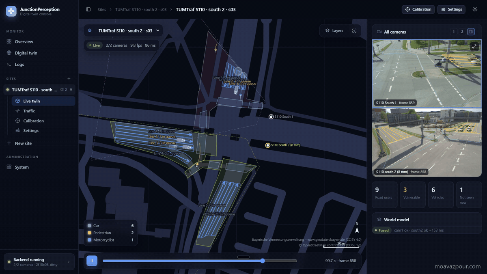
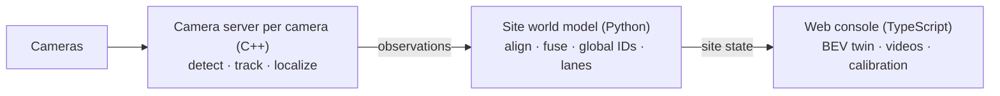

# JunctionPerception — Multi-Camera Intersection Digital Twin

[](https://github.com/moavazpour/JunctionPerception/actions/workflows/ci.yml)



Traffic cameras at an intersection see road users only as pixels, one camera at a time.
JunctionPerception turns the video of one or more fixed cameras into one live, metric bird's-eye
view of the intersection. Every vehicle, cyclist and pedestrian gets a map position, speed,
heading and one identity across all cameras.

## Key features

- Calibration by clicking a few points in the camera image and on the map; camera pose estimated.
- YOLO26 detection, ByteTrack tracking, ground-plane localization with uncertainty (C++, CUDA).
- Multi-camera fusion with global IDs that survive occlusions and ID switches.
- Lane queues and passing vehicles, traffic-light state.
- Web console: live twin, camera videos, calibration, playback; runs on recordings or live streams.

## Architecture



Details: [docs/architecture.md](docs/architecture.md).

## Results

Twin output against the TUMTraf Intersection LiDAR labels (2 cameras, 1 315 frames, day), with
our own map calibration only and a detector not trained on TUMTraf:

| Distance from camera | Within 2 m of the true position | Median error |
|---|---|---|
| 0–40 m | 85 % | 0.54 m |
| 40–60 m | 25 % | 0.57 m |

Median heading error: 3.8°. Method: [docs/evaluation.md](docs/evaluation.md).

## Install and run

Needs Docker (with the NVIDIA Container Toolkit for GPU inference).

```bash
git clone https://github.com/moavazpour/JunctionPerception.git && cd JunctionPerception
scripts/setup_server.sh
scripts/in_docker.sh scripts/build_and_test.sh all release
JP_SERVER_ADDRESS=<LAN address> JP_DATA_ROOT=<video folder> scripts/run_manager.sh
```

Open `http://<LAN address>:8080/`, add a site, calibrate its cameras. Models go into `models/`
(`tools/export_yolo26.py`).

## Limitations and docs

- The detector is COCO-pretrained; it degrades at night and in rain.
- Planar ground, no 3D detection; error grows with distance and with calibration error.
- Fusion needs all cameras calibrated into one frame and on one clock.

[Architecture](docs/architecture.md) · [Evaluation](docs/evaluation.md) ·
[Map data](docs/map-data.md) · [Decisions](docs/adr/) · [Contributor rules](AGENTS.md)

## Next steps

- 3D perception, compared with the current 2D approach.
- Traffic analysis from the twin's output.
- Improvement suggestions for the intersection.
- A live agent that proposes improvements to the intersection's operation, without controlling it.

## Credits and license

TUMTraf Intersection dataset (Zimmer et al., ITSC 2023), Ultralytics YOLO26, ByteTrack (Zhang et
al., ECCV 2022), ONNX Runtime, OpenCV, PROJ, Eigen. Map data: Bayerische Vermessungsverwaltung
(CC BY 4.0), © OpenStreetMap contributors (ODbL 1.0).

MIT – see [LICENSE](LICENSE). Datasets, model weights and map data keep their own licenses.
