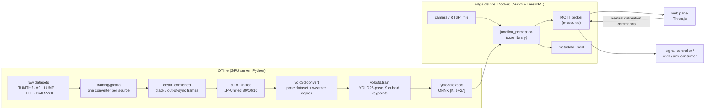
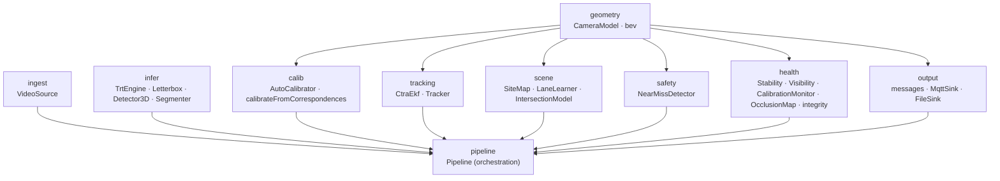
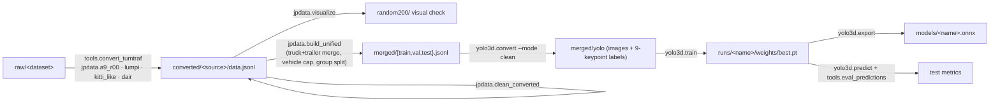

# Code architecture

This document describes the whole code base of JunctionPerception: how the parts fit together, what each
directory and file does, how one camera frame flows through the runtime, which threads exist, how the
detector is trained and how it reaches the device. Design rationale and algorithms in more depth are in
[ARCHITECTURE.md](ARCHITECTURE.md); message schemas in [INTERFACES.md](INTERFACES.md); the dataset
specification in [DATASET.md](DATASET.md); operation in [DEPLOYMENT.md](DEPLOYMENT.md).

## 1. The system in one picture



Only metadata leaves the runtime. Frames stay in process memory; the single exception is an optional,
downscaled snapshot with every road user pixelated, used by the calibration view.

## 2. Repository layout

```
CMakeLists.txt            top-level build (C++20; options JP_WITH_TENSORRT, JP_WITH_MQTT)
cmake/                    find modules for TensorRT and paho MQTT
core/                     the C++ library (jp_core, jp_infer)
  include/jp/...          public headers, one directory per module
  src/...                 implementations
apps/
  junction_perception/    the runtime executable (one process per camera)
  jp_bench/               benchmark runner: TensorRT detector + lifting over a dataset split or a video
tests/                    GoogleTest unit tests (geometry, tracking, safety, calibration)
web/                      TypeScript + Three.js panel (Vite build, served by nginx)
training/                 Python: data conversion, training, export, evaluation
tools/                    site setup, training and deployment scripts, report helpers
configs/sites/            one YAML per camera/site
docker/                   Dockerfiles (x86 dGPU, Jetson, web), mosquitto and nginx config
docker-compose.yml        edge stack: broker + one perception service per camera + web panel
docs/                     documentation
```

Build targets:

| Target | Sources | Depends on | GPU |
|---|---|---|---|
| `jp_core` (static lib) | geometry, tracking, scene, safety, health, calib, ingest, output | Eigen, OpenCV, nlohmann-json, spdlog, yaml-cpp, paho-mqtt (optional) | no |
| `jp_infer` (static lib) | `infer/trt_engine.cpp`, `infer/detector.cpp`, `pipeline.cpp` | `jp_core`, TensorRT, CUDA | yes |
| `junction_perception` | `apps/junction_perception/main.cpp` | `jp_infer` | yes |
| `jp_bench` | `apps/jp_bench/main.cpp` | `jp_infer` | yes |
| `jp_tests` | `tests/*.cpp` | `jp_core`, GTest | no |

Everything except inference and the pipeline builds and tests without a GPU (`-DJP_WITH_TENSORRT=OFF`).

## 3. Coordinate frames and conventions

| Frame | Definition | Used by |
|---|---|---|
| image | undistorted pixels of the original frame (u right, v down) | detections, keypoints, snapshot |
| network input | letterboxed square (e.g. 960 × 960), 114-grey padding | inside `Detector3D` only |
| camera | OpenCV: x right, y down, z forward (m) | `CameraModel` internals, dataset labels |
| ground | local ENU: x east, y north, z up, origin on the ground directly below the camera | tracking, scene, safety, all outputs |
| WGS84 | latitude / longitude | `lat`/`lon` fields, CPM, map priors (`geoToEnu` / `enuToGeo`) |

The ground plane in camera coordinates is `n·X + d = 0` with `n` pointing up, so `d` is the camera
height. A camera model is fully described by the image size, `K`, that plane, the compass bearing of the
horizontal viewing direction and a WGS84 anchor.

The 9 keypoints of every object: `k0` bottom centre, `k1–k4` bottom FL FR RR RL, `k5–k8` top FL FR RR RL
(amodal, i.e. predicted also when occluded). Mirroring swaps left/right with
`flip_idx = [0, 2, 1, 4, 3, 6, 5, 8, 7]`.

Classes (shared by Python and C++, order matters): `car, bus, truck, trailer, pedestrian, bicycle,
escooter, motorcycle` (`core/include/jp/common/types.hpp` ↔ `training/jp3d/geometry.py`). Trailers are
merged into trucks in the data, so the trained model emits no trailers; e-scooter has no data yet.

## 4. C++ library (`core/`)

### 4.1 Module map



### 4.2 Files and responsibilities

| Module | Header (`core/include/jp/`) | Main types | What it does |
|---|---|---|---|
| common | `common/types.hpp` | `ObjectClass`, `ImageDetection`, `Detection3D`, `classPriorDims` | shared value types; class list and prior sizes |
| geometry | `geometry/camera.hpp` | `CameraModel`, `GeoAnchor`, `geoToEnu`, `enuToGeo` | pinhole camera over a planar ground: pixel ↔ ground, box projection, keypoint lifting, JSON (de)serialisation, small-rotation correction |
| | `geometry/bev.hpp` | `OrientedBox`, `Polyline` | oriented-rectangle overlap and distance (SAT), polylines for lanes and zones |
| ingest | `ingest/video_source.hpp` | `VideoSource`, `VideoSourceConfig` | one interface for `file://`, `rtsp://`, `usb:`/`v4l2://`, `gst:` pipelines; real-time pacing, looping, reconnects |
| infer | `infer/trt_engine.hpp` | `TrtEngine`, `TensorInfo` | TensorRT 10 wrapper: builds an engine from ONNX on first use and caches it next to the ONNX (per GPU and precision), owns device buffers and a CUDA stream |
| | `infer/detector.hpp` | `Letterbox`, `Detector3D`, `Segmenter` | undistortion + letterbox in one remap; detector decoding for the YOLO26-pose layout `[K, 6+27]` (and the older `[K, 13]`); SegFormer semantic segmentation for static occlusion and visibility |
| calib | `calib/auto_calibrator.hpp` | `AutoCalibrator`, `CalibrationPriors`, `CalibrationResult` | self-calibration from traffic (keypoint 4-DoF search or vanishing-point path), bearing from the map |
| | `calib/manual_calibration.hpp` | `calibrateFromCorrespondences`, `GroundCorrespondence` | camera from ≥ 4 image ↔ map point pairs (homography focal estimate, PnP over a focal search, camera position solved) |
| tracking | `tracking/tracker.hpp` | `CtraEkf`, `Track`, `Tracker` | CTRA extended Kalman filter `[x, y, yaw, v, yaw_rate, a]`; two-stage (high/low score) association with Mahalanobis gating and Hungarian assignment; coasting through occlusions |
| scene | `scene/site_map.hpp` | `Lane`, `Zone`, `SiteMap`, `LaneLearner` | site map (lanes, stop lines, zones, crosswalks); lane learning from traffic and stop lines from queue heads |
| | `scene/intersection.hpp` | `RoadUser`, `LaneState`, `ZoneState`, `StopLineCrossing`, `IntersectionModel` | lane assignment, distance and ETA to the stop line (with acceleration), queues, virtual detectors, stop-line crossings |
| safety | `safety/near_miss.hpp` | `NearMissDetector`, `ConflictMetrics`, `NearMissEvent` | TTC (oriented footprints), MTTC (CTRA prediction), PET (grid of occupancy times), DRAC, hard braking; event lifecycle with severity |
| health | `health/monitors.hpp` | `StabilityMonitor`, `VisibilityMonitor`, `CalibrationMonitor`, `OcclusionMap`, `HealthReport` | camera shake/drift/moved (feature tracking → per-frame rotation correction), image quality and weather conditions, calibration consistency, static/dynamic occlusion per lane, fused integrity level |
| output | `output/messages.hpp` | `msg::objects`, `msg::cpm`, `msg::health`, … | JSON schema of every topic, ETSI CPM content |
| | `output/sink.hpp` | `Sink`, `MqttSink`, `FileSink`, `MultiSink` | publishing (MQTT async with reconnect and offline queue, JSON-lines file) and operator command subscriptions |
| pipeline | `pipeline.hpp` | `PipelineConfig`, `Pipeline` | YAML config, orchestration of everything above, rates, self-healing, operator commands |

### 4.3 One frame through the runtime

```mermaid
sequenceDiagram
  participant Cap as capture thread
  participant P as Pipeline::process
  participant D as Detector3D (TensorRT)
  participant C as CameraModel
  participant T as Tracker
  participant S as Scene + Safety
  participant H as Health
  participant O as Sinks (MQTT / file)
  Cap->>P: newest frame + timestamp (older frames dropped)
  P->>P: apply queued operator commands
  P->>D: Letterbox (undistort + resize) → infer
  D-->>P: ImageDetection[] (box, class, 9 keypoints)
  alt not calibrated yet
    P->>P: AutoCalibrator.add(); when ready, solve() on a worker thread
    P->>O: health "auto-calibration n %", snapshot
  else calibrated
    P->>H: StabilityMonitor → per-frame rotation correction
    P->>C: lift each detection (keypoints → footprint, heading, size)
    P->>T: update(stamp, Detection3D[], occlusion test)
    P->>S: lane learning, IntersectionModel.update, NearMissDetector.update
    P->>H: calibration consistency, occlusion (static every 2 s via SegFormer, dynamic every 0.2 s), visibility
    P->>P: self-healing (absorb drift, recalibrate when invalid or moved)
    P->>O: objects, cpm, detectors, detector/<zone>, events, health, occlusion (each at its own rate)
  end
```

Details:

1. **Capture.** A dedicated thread reads the source and keeps only the newest frame, so processing never
   works on stale video. Files without real-time pacing run in lock-step instead (no drops), which is
   what benchmarks and replays use.
2. **Detection.** `Letterbox` maps the raw frame to the network input in one `remap` (undistortion
   included when distortion is configured). `Detector3D` normalises to RGB 0–1, runs TensorRT and
   maps boxes and keypoints back to undistorted frame pixels.
3. **Calibration.** Until a calibration exists the detections feed `AutoCalibrator` (≈ 45 s of
   traffic). The solve runs on a worker thread; meanwhile health and the snapshot keep flowing. A stored
   calibration file is loaded at start when the resolution matches.
4. **Stabilisation.** `StabilityMonitor` tracks background features against the calibration frame and
   returns the camera rotation; the frame's camera model is the calibrated one rotated by it. A
   persistent rotation is absorbed into the calibration after 30 s.
5. **Lifting.** `CameraModel::liftKeypoints` intersects the confident footprint corners with the ground
   (a missing fourth corner is completed as a parallelogram), estimates the height from the top
   corners, and falls back to the bottom centre plus class priors. Objects beyond `max_range_m` are
   dropped.
6. **Tracking.** `Tracker::update` predicts all tracks with the CTRA filter, associates high-score
   detections first and low-score ones second, confirms after 3 hits and coasts unmatched tracks
   (longer when the occlusion map says the position is hidden).
7. **Scene.** Moving confirmed vehicles feed `LaneLearner`; lanes are rebuilt after 600 samples and then
   every 30 s, extended to the configured stop-line reference. `IntersectionModel` assigns lanes and
   computes distance and ETA to the stop line, queues, zone occupancy and crossings.
8. **Safety.** `NearMissDetector` evaluates pairs within 40 m: TTC, MTTC, PET, DRAC, hard braking, and
   opens / updates / closes events with severity.
9. **Self-monitoring.** Calibration consistency, occlusion and visibility are fused by
   `assessIntegrity` into `ok / degraded / fault` with a confidence and human-readable reasons. An
   invalid calibration or a moved camera for 60 s restarts auto-calibration.
10. **Outputs.** Each topic has its own rate (`output.rates_hz`); detector states are also published on
    change. Everything goes through `MultiSink` to MQTT and/or a JSON-lines file.

### 4.4 Threads

| Thread | Owner | Work |
|---|---|---|
| main | `Pipeline::run` | processing loop (`process`), all state |
| capture | `Pipeline::run` | `VideoSource::read`, newest-frame hand-over |
| calibration solve | `std::async` in `process` | `AutoCalibrator::solve()` (reads the calibrator only; commands that replace the calibrator wait for it) |
| MQTT | paho | network I/O; command callbacks only enqueue JSON under a mutex, the main thread applies them |

### 4.5 Calibration

`AutoCalibrator` collects image-space tracks of vehicles (IoU association, truncated boxes skipped) and,
when ready, solves:

- **Keypoint path** (deployed model). For a candidate focal length, pitch and roll at unit camera
  height, every car with 8 confident corners is lifted, a box is fitted to its 9 keypoints by
  Levenberg–Marquardt in pixels, and the costs are summed: re-projection error, spread of the per-car
  scale against the class prior (the scale gives the height in closed form, combined with the installer's
  prior), speed change between the near and far halves of tracks, roll and height priors. Coarse grid →
  Nelder–Mead from the 5 best seeds. The dominant direction of travel is aligned with the OpenStreetMap
  road bearing to fix the compass orientation.
- **Vanishing-point path** (box-only models). Road vanishing point from straight tracks, then focal
  length, rotation about the road axis and height.
- **Manual path** (operator). `calibrateFromCorrespondences`: ground homography → focal estimate, IPPE +
  iterative PnP over a focal search, camera position solved, accepted when the reprojection error is
  small. Triggered from the web panel through `…/calibration/manual`.

Calibrations are persisted to `calibration.file` and published (retained) on `calibration`.

### 4.6 Configuration

`PipelineConfig::fromYaml` reads one site YAML (`configs/sites/*.yaml`):

| Section | Keys |
|---|---|
| `site` | `id`, `name` |
| `camera` | `id`, `source` URI, `realtime`, `loop`, `max_fps`, `position` (lat, lon, height_m, height_sigma, bearing_deg), optional `intrinsics` (focal_px, distortion) |
| `calibration` | `file`, `force`, `min_duration_s`, `publish_snapshot`, `road_bearing_deg` (from `tools/osm_site.py`) |
| `map` | `file` (hand-made map overrides learning), `learn_lanes`, `stop_line` (lat/lon), `crosswalks` |
| `models` | `detector` (ONNX), `segmentation` (ONNX), `fp16`, `score_threshold`, `max_range_m` |
| `output` | `topic_prefix`, `mqtt` (uri, credentials), `file`, `station_id`, `rates_hz` |
| `health` | `target_fps` |
| `state_dir` | calibration, learned map, recordings |

### 4.7 Applications

- `junction_perception --config site.yaml [--max-frames N] [--no-realtime] [--recalibrate]`: the
  runtime; SIGINT/SIGTERM stop it cleanly.
- `jp_bench --onnx M --data split.jsonl --images ROOT --out preds.jsonl`: runs the deployed TensorRT
  detector and the runtime's lifting over a dataset split (camera-frame predictions for
  `tools.eval_predictions`); `--video` dumps calibration-free detections of a video.

## 5. Interfaces

- **MQTT topics** `<prefix>/<site>/<camera>/<leaf>`: `objects`, `cpm`, `detectors`, `detector/<zone>`,
  `events/safety`, `events/stopline`, `health`, `occlusion`, `calibration`, `map`, `snapshot`,
  `calibration/manual/result`; subscribed: `calibration/manual` (operator commands). Full schemas in
  [INTERFACES.md](INTERFACES.md).
- **Signal controllers** read the retained `detector/<zone>` presence topics (`"0"`/`"1"`), the
  simplest loop-detector emulation; richer consumers use `detectors` and `objects`.
- **V2X**: `cpm` carries ETSI TS 103 324 CPM content in the standard's units, ready for an ASN.1 encoder.

## 6. Web panel (`web/`)

| File | Role |
|---|---|
| `src/main.ts` | MQTT over WebSocket (`/mqtt` through nginx), message routing, side panels (road users, lanes, safety, coverage, calibration) |
| `src/scene3d.ts` | Three.js scene: road, lanes, zones, occlusion overlay, animated road users, chase / top / camera views |
| `src/models.ts` | low-poly vehicle, pedestrian and cyclist models |
| `src/calib.ts` | calibration view: snapshot with range rings and learned lanes projected through the camera model |
| `src/manual.ts` | manual calibration: click points in the snapshot and on an aerial map (Leaflet), solve, restart auto |
| `src/types.ts` | TypeScript types of all messages |

Built by `docker/Dockerfile.web` (Vite) and served by nginx, which also proxies the broker's WebSocket.

## 7. Training and data (`training/`)



| Package / file | Role |
|---|---|
| `jp3d/geometry.py` | shared geometry (box corners, projection, plane fitting, classes and priors) — the Python twin of `CameraModel` |
| `jp3d/weather.py` | fog, rain, night, glare, droplets, blur, JPEG |
| `jp3d/evaluate.py` | ground-plane 3D metrics (BEV matching, AP, position / size / heading errors) |
| `jp3d/model.py`, `dataset.py`, `loss.py`, `lift.py`, `data/tumtraf.py`, `train.py`, `export_onnx.py` | the earlier GroundCenter3D baseline (kept for benchmarks) |
| `export_segformer.py` | SegFormer-B2 Cityscapes → ONNX with in-graph argmax |
| `jpdata/a9_r00.py`, `lumpi.py`, `kitti_like.py`, `dair.py`, `tools/convert_tumtraf.py` | one converter per source, each handling that dataset's calibration and label conventions (see DATASET.md §4) |
| `jpdata/clean_converted.py` | removes ignore regions, out-of-sync cameras and black frames |
| `jpdata/truck_merge.py` | tractor + trailer → one truck box |
| `jpdata/build_unified.py` | merge, vehicle-side cap, balanced group split per source, summary |
| `jpdata/visualize.py` | labelled visual checks (cuboids, front edge, optional 2D boxes and class names) |
| `jpdata/qc.py`, `detect_all.py`, `verify.py`, `label_audit.py` | analysis tools used while building the data (not part of the final pipeline) |
| `yolo3d/convert.py` | JP-Unified → Ultralytics pose dataset (`kpt_shape [9,3]`, `flip_idx`), weather copies |
| `yolo3d/train.py` | YOLO26-pose training with geometry-safe augmentation (no rotation/shear/perspective) |
| `yolo3d/export.py` | ONNX export, layout check |
| `yolo3d/predict.py`, `lift.py` | PyTorch inference + lifting for evaluation |
| `tools/eval_predictions.py` | evaluates jp_bench / PyTorch predictions against a split |
| `tools/make_tumtraf_video.py` | TUMTraf sequence → video for runtime replays |
| `tools/carla_gen.py` | CARLA generator (evaluated, not used: it lowered real-data accuracy) |

Data on the server: `raw/` (extracted datasets only), `converted/<source>/` (data.jsonl, image root,
visual checks), `merged/` (splits, YOLO export, visual check), `runs/` (training and deployment
reports), `models/` (ONNX + cached TensorRT engines), `state/` (runtime state and recordings).

## 8. Scripts (`tools/`)

| Script | Role |
|---|---|
| `osm_site.py` | site priors from OpenStreetMap: road bearing, stop-line reference, crosswalks |
| `train_merged.sh` | export the YOLO dataset, train, evaluate once on the test split |
| `deploy_model.sh` | after training: export, runtime image + unit tests, TensorRT benchmark per source on the test split, TUMTraf calibration check against ground truth, test-site run |
| `compare_calibration.py` | calibration file vs. ground truth (focal, pitch, roll, height, range error) |
| `summarize_metadata.py` | summary of a metadata recording (calibration, tracks, speeds, lanes, events, health) |
| `run_benchmark.sh`, `final_training.sh` | earlier benchmark / training drivers (GroundCenter3D, CARLA ablation) |

## 9. Deployment

- `docker/Dockerfile`: TensorRT 24.08 base; build stage compiles and runs the unit tests, runtime stage
  carries only the binaries and runtime libraries; entrypoint `junction_perception`.
- `docker/Dockerfile.jetson`: the same for JetPack 6 on Jetson Orin (engines are rebuilt on the device).
- `docker-compose.yml`: `mosquitto`, `perception-cam1` (one service per camera, each with its own site
  YAML), `web` on port 8080. Volumes: `/models`, `/data/state`, `/data/videos`, `/config`.

## 10. Tests

`jp_tests` (GoogleTest, 22 tests, no GPU): camera geometry and lifting, BEV geometry, CTRA filter and
tracker, near-miss metrics, auto-calibration on synthetic traffic (vanishing-point path and three
keypoint scenarios: footbridge phone, gantry camera, wide-angle low mount) and manual calibration from
map points. The Docker build runs them; `tools/deploy_model.sh` adds the end-to-end checks on real data.

## 11. Status and known limits

- The detector is the only trained component; all other parts are algorithmic.
- E-scooter riders: class reserved, no training data.
- Jetson: image provided, not yet validated on a device; INT8 not yet calibrated.
- RTSP/USB sources are implemented but only file sources have been tested on real footage.
- Auto-calibration accuracy depends on traffic and keypoint quality; the manual fallback covers sites
  where it is not good enough.
