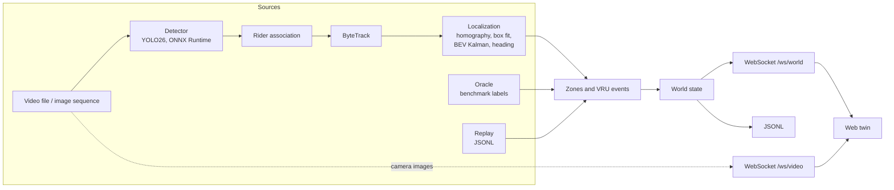

# Architecture

## Data flow



All three sources (`live`, `oracle`, `replay`) produce the same world objects, which pass through
the same zone and event code before they are published.

## Modules

| Module | Responsibility |
|---|---|
| `core` | Shared types (world state), configuration, class catalog, assignment, statistics |
| `io` | Frame sources: video files (presentation timestamps kept), image sequences |
| `benchmark` | TUMTraf Intersection R02 reader, label registration and merging |
| `calibration` | Ground plane, image-to-ground homography, camera model, benchmark calibration |
| `detection` | `Detector` interface, YOLO26 end-to-end ONNX Runtime backend (boxes, or boxes with the four bottom corners of the 3D box), rider association |
| `tracking` | ByteTrack in image space |
| `localization` | Ground contact, contact-to-centre correction (box fit) or corner footprint (keypoint models), BEV Kalman filter, heading, size, validated region |
| `vru` | Zones (GeoJSON), crosswalk occupancy, VRU-vehicle conflicts, turning flag |
| `evaluation` | Benchmark metrics: matching to labels, detection, localization, motion, tracking, conflicts |
| `sources` | World sources: live pipeline, oracle (benchmark labels), replay (JSONL); detection areas and lines per camera |
| `twin` | World-state JSON and JSONL, debug overlay and top-down videos |
| `server` | HTTP API, WebSockets, real-time playback, static frontend |
| `apps` | `jp_run`, `jp_server`, `jp_calibrate`, `jp_eval` command-line programs |

## Coordinate frames

| Frame | Unit | Description |
|---|---|---|
| `image` | px | Camera image. Custom videos are assumed free of lens distortion. |
| `scene_ground` | m | Metric plane of a scene, z = 0 on the ground. For benchmark scenes it is the ground plane fitted to the labelled boxes in the camera's view, defined in the south LiDAR frame (`sensor_from_ground` in `ground_homography.yaml`). |
| `world` | m | Local ENU tangent plane at the scene's geo anchor. Until a scene has a geo anchor, `world` equals `scene_ground`. |
| `wgs84` | deg | Latitude / longitude, for control points, zones and the geo anchor. |
| `benchmark` | m | TUMTraf label frame (south LiDAR). |

Zones (`scenes/<id>/zones.geojson`) declare their frame in the foreign member
`coordinate_frame`; `scene_ground` is supported, WGS84 zones require the scene's geo anchor.

## World state (schema version 1)

One JSON object per frame, sent on `/ws/world` and written as one line per frame in JSONL files.
Example: [`tests/fixtures/world_state_v1.json`](../tests/fixtures/world_state_v1.json); the C++
serializer and the frontend types are both tested against it.

| Field | Type | Description |
|---|---|---|
| `schema_version` | int | `1` |
| `scene_id` | string | Scene folder name |
| `frame` | int | Frame index of the source |
| `timestamp_ns` | int | Capture time (ns); relative to the first frame for video files |
| `source` | string | `live`, `oracle` or `replay` |
| `objects` | array | Road users, see below |
| `events` | array | Active events, and events in the frame they end |
| `signals` | array | Traffic lights of the camera: `id`, `name`, `state` (`red`, `yellow`, `red_yellow`, `green`, `off`, `unknown`), `confidence`, `since_ns` (when the state began); absent in older recordings |

Object fields: `id` (track ID), `class` (twin class), `vru`, `rider` (two-wheeler with rider),
`x`, `y` (footprint centre, m, world frame), `vx`, `vy` (m/s), `heading_rad` (counter-clockwise
from +x, `null` until the object has moved), `speed_mps`, `speed_std_mps` (speed uncertainty of
the tracking filter, `null` where not estimated), `confidence`, `zones` (IDs of the zones
containing the object), `turning` (vehicle heading changed by more than the configured angle over
the configured window), `validated` (inside the region validated for safety events; see below),
`length_m`, `width_m` (footprint measured from the box corners of a keypoint model, smoothed over
the track; `null` or absent otherwise, then the twin uses the class size).

Event fields: `id`, `type` (`VRU_VEHICLE_CONFLICT`, `VRU_ON_CROSSWALK`), `state` (`active` or
`ended`), `object_ids` (conflicts: vehicle, then VRU), `min_distance_m` and `time_to_closest_s`
(conflicts: smallest predicted gap between the vehicle footprint and the VRU, and when it
occurs), `closing_speed_mps` (conflicts: average speed at which that gap shrinks),
`vehicle_state` (conflicts: `moving`, `stopped` or `starting`), `zone` (crosswalk, or the VRU's
zone for conflicts; `null` otherwise).

## Keypoint detector

A detector may also return keypoints: `models/jp_pose5_736x1280.onnx` (classes car, pedestrian,
bike, Trucks, Buses; class source `jp_pose5`) gives, per detection, the four bottom corners of the
object's 3D box (x, y, visibility), in an end-to-end output of shape (1, 300, 6 + 4 × 3) at a
1280 × 736 letterboxed input (the size is read from the model; trained at 640, it finds clearly
more at 1280: TUMTraf recall 0.52 instead of 0.44). When all four corners are visible, the
localizer projects them to the ground: their centre is the measurement (it needs no footprint
model, so its floor is smaller, `localization.keypoints.floor_std_m`), the sides give length and
width, and the corner order gives the heading with its front, also of standing road users: the
model lists the front corners first (0, 1), then the rear ones (2, 3), measured right for 95–100 %
of moving vehicles. A corner heading against a clear motion (above `motion_min_speed_mps`) is a
momentary error and is turned round; for slow road users a reversal counts only after
`flip_frames` frames in a row. On TUMTraf the corner centre lies 0.4–0.5 m towards the camera
compared with the box fit, but it is matched far more often (precision 0.51, recall 0.54, IDF1
0.49 against 0.49, 0.52, 0.47 with the box fit); `position_weight` mixes in the box fit. Corner
sets whose size is implausible for the class fall back to the box model. Select the model with
`detection.model` and `detection.class_source` in `configs/pipeline.yaml`.

## Detection areas and counting lines

Each camera may have `regions.json` next to its calibration, edited in the console (Calibration,
"ROI and lines") on the camera image: areas (ROI polygons) and lines (polylines), in image pixels.
A detection counts only if its ground contact (the centre of its corners, else the bottom centre
of its box) lies inside one of the areas, if there are any, and within `band_m` of a line that
has a band, if there is one. Everything else is dropped before tracking: it is neither tracked,
shown nor counted. This keeps far, small and mutually occluded road users, which the detector
cannot separate reliably, out of the twin. Saving applies the regions to the running server at
once (`GET`/`POST /api/regions`).

## Traffic lights

A camera's `regions.json` may also hold signal areas: the head of a traffic light on the camera
image (drawn in Calibration, "ROI and lines", "Finish signal"). Every frame, the server reads
the colour of its lit lamp: pixels that are bright, clearly brighter than the rest of the area
and saturated count as lit, and their hue tells red, yellow (amber) and green apart; red and
yellow together are red-amber. A new colour is reported once it lasted `signals.confirm_frames`
frames, and short unlit readings (LED flicker against the shutter, an occluding truck) keep the
last colour for `signals.hold_frames` (`configs/pipeline.yaml`). The states are part of the world
state (`signals`) and drawn on the camera image. In the live twin, "Traffic lights" places each
signal: click where it stands, then towards the traffic it faces; its height is set in the same
bar. The position is stored with the signal in the site's world frame, and the twin shows a
signal head whose lamps follow the camera's reading.

## Traffic statistics

The site manager follows every running camera's world stream and maps the camera's lines to the
ground with its calibration. A road user whose ground track crosses a line is recorded once
(SQLite, `.cache/manager/stats.sqlite`) with time, class, direction (A: from the left of the line
as drawn to its right, on the ground) and speed; safety events are recorded when they start, and
the time each camera counted is kept, so rates refer to observed time. The statistics page
reports per line and period the measures used for design and signal timing (FHWA Traffic
Monitoring Guide, HCM): volume per interval and type, flow rate in vehicles and passenger car
units per hour, peak hour and peak hour factor, heavy-vehicle share, directional split, spot
speeds (time-mean and space-mean speed, percentiles, pace, share over the limit), headways,
density, turning movements between the lines of a camera, vulnerable road users and safety
events; the raw crossings export as CSV.

## Position uncertainty and safety events

A camera resolves ground positions anisotropically: along the viewing ray one pixel covers
range² / (focal length × camera height) of ground, across it only range / focal length. The
tracking filter therefore maps an image noise of the box bottom (pixels) through the homography
into an anisotropic, range-dependent measurement covariance, plus a floor for the footprint
model and the calibration. Measurements that the motion model cannot explain (a box briefly
covering two objects, a swapped track) are not fused; if they persist, the track is re-anchored
with unknown velocity. Process noise is set per class (pedestrians accelerate less than cars).

Conflicts are predicted at constant velocity over a short horizon, but only from velocities the
filter knows well (`speed_std_mps`); new or re-anchored tracks are predicted to stay in place. A
pair is in conflict when the predicted gap between the vehicle's footprint rectangle and the VRU
falls below a threshold while it is actually closing, so road users that are merely close
(waiting next to a stopped car, passing in parallel) are not. Stopped vehicles take part: a VRU
moving into one is a conflict with `vehicle_state` `stopped`, a vehicle pulling away from a stop
towards a VRU is `starting`.

For scenes calibrated from control points, safety events are limited to positions within a
margin of the control points and where one pixel along the viewing ray is at most a configured
amount of ground. Objects outside are tracked and shown (drawn faded) but take part in no
events. Benchmark scenes, registered to LiDAR labels, are not restricted.

## Server interface

| Endpoint | Description |
|---|---|
| `GET /api/scene` | Scene description: camera, image size, camera ground position, zones, class catalog |
| `GET /api/status` | Playback state, frame, frame rate, processing latency, road users, active events, clients |
| `POST /api/playback` | `{"action": "play"}`, `{"action": "pause"}`, `{"action": "seek", "frame": n}` |
| `WS /ws/world` | World state per frame (text) |
| `WS /ws/video` | Camera images (binary): 8-byte little-endian frame index followed by a JPEG, rate-limited |
| `GET /api/frame` | Latest camera image (JPEG), for the calibration tool |
| `GET /api/calibration` | Control points of the scene |
| `POST /api/calibration/fit` | Fits control points: homography, residuals per point, camera pose |
| `POST /api/calibration/save` | Fits and saves control points and calibration (optional camera position and height) |
| `POST /api/zones` | Saves the zones of the scene (GeoJSON, scene ground frame); events use them at once |
| `POST /api/restart` | Restarts the server, e.g. to apply a new calibration |
| `GET /map/...` | Map layers of the scene (`map_cache/<scene>`, see docs/map-data.md) |
| `GET /` | Built frontend (`web/dist`) when the server runs on its own (`scripts/run_server.sh`) |

Recordings are played in real time on their own timestamps (`configs/server.yaml`). Inputs
containing `://` (RTSP, HTTP) are opened as camera streams; they report no frame count and cannot
seek.

## Site manager and console

`manager/jp_manager.py` (Python, aiohttp; `configs/manager.yaml`) is the always-on service behind
the web console. A site is one intersection with up to four cameras:

```text
scenes/<site>/scene.yaml                world frame: east-north-up at the intersection centre
                                        (geo_anchor), map radius
scenes/<site>/zones.geojson             zones, shared by all cameras of the site
scenes/<site>/site.yaml                 console settings: name, active, per camera its source,
                                        playback and video stream (kept out of git)
scenes/<site>/cameras/<camera>/         camera.yaml (name, approach: the arm it watches, image
                                        size) and the camera's calibration
```

Every camera has its own calibration into the shared world frame, so the road users of all cameras
meet in one twin of the intersection. Older single-camera scene folders (calibration next to
`scene.yaml`, e.g. the benchmark scenes) are sites with one camera; a console-made one becomes an
intersection when a camera is added. The manager runs one `jp_server` per active camera on a local
port with a generated server config (at most `max_running` at once), restarts servers that exit (a
calibration "apply" exits on purpose; crashes back off up to 30 s), keeps their output as logs
(source `<site>/<camera>`) and proxies each camera under `/sites/<id>/cameras/<camera>/` (HTTP and
WebSockets). Stopping the backend stops
all servers but keeps the console; the state survives restarts (`.cache/manager/state.json`).

| Endpoint | Description |
|---|---|
| `GET /manager/api/sites` | Sites with their cameras, settings, process state and live status |
| `POST /manager/api/sites` | Creates an intersection (scene folder, cameras, `site.yaml`, optionally its map layers) |
| `PATCH`, `DELETE /manager/api/sites/<id>` | Name, location, map area or placement; moves the site to the trash |
| `POST /manager/api/sites/<id>/<action>` | `start`, `stop`, `restart` (all cameras), `prepare-map` |
| `POST /manager/api/sites/<id>/cameras` | Adds a camera |
| `PATCH`, `DELETE /manager/api/sites/<id>/cameras/<camera>` | Changes a camera (restarts it if running); moves it to the trash |
| `POST /manager/api/sites/<id>/cameras/<camera>/<action>` | `start`, `stop`, `restart` |
| `GET /manager/api/system` | Version, backend state, CPU, memory, disk, GPUs (`nvidia-smi`) |
| `POST /manager/api/system/<action>` | `start-backend`, `stop-backend`, `restart-backend`, `restart-manager` |
| `GET /manager/api/inputs` | Videos and sequences below the data root, recorded replays |
| `GET /manager/api/probe?input=` | Image size, frame rate and length of a video or stream (`jp_server --probe`) |
| `POST /manager/api/videos` | Uploads a video (multipart `file`) to `<data root>/uploads` |
| `GET /manager/api/logs`, `/logs/stream` | Recent log lines of the manager or a site; live as server-sent events |
| `* /sites/<id>/cameras/<camera>/...` | The camera's server (the endpoints above) |
| `* /sites/<id>/map/...` | Map layers of the site, also while it is stopped |

The console (`web/`) has one page per view sharing a sidebar: overview, live twin, calibration,
site settings, new site, system and logs, in a night or day theme. It has no authentication:
publish it on a trusted network only.

**Map placement.** Custom scenes are geo-referenced: their world frame is east-north-up at
`geo_anchor`, and the map layers are built in it. Benchmark scenes use a sensor frame (the south
LiDAR of TUMTraf); their location is stored as `map.anchor`, the map is built around it and placed
in the scene by `map.transform` (yaw and offset, `scene = R(yaw) · map + t`), adjusted in the twin
with *Align map*. The default yaw of the TUMTraf scenes follows from the label poses.

**The twin of all sites.** The twin page draws every site with a location at its geographic
position (east and north of the first site), each with its map, zones and camera masts; the picker
flies between the intersections. Where the views of an intersection's cameras overlap, close tracks
of different cameras of the same kind that move alike are merged into one road user (gates 3 m for
vehicles, 1.5 m for VRUs, kept up to 1.6 times that once matched); a merged road user keeps its key
while any camera still sees it, so hand-overs between cameras neither flicker nor jump.

**Road users in the twin.** New tracks fade in and leaving ones fade out while moving on. They
enter facing the direction of traffic learned per grid cell from earlier vehicle tracks (kept per
site in the browser), else the direction of a one-way OpenStreetMap road or the road axis; the drawn
heading then turns towards the track's own heading at a limited rate, so vehicles never spin.
