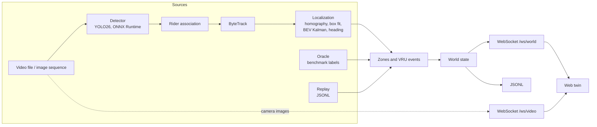

# Architecture

## Data flow

All three sources (`live`, `oracle`, `replay`) produce the same world objects, which pass through
the same zone and event code before they are published.

## Modules

| Module | Responsibility |
|---|---|
| `core` | Shared types (world state), configuration, class catalog, assignment, statistics |
| `io` | Frame sources: video files (presentation timestamps kept), image sequences |
| `benchmark` | TUMTraf Intersection R02 reader, label registration and merging |
| `calibration` | Ground plane, image-to-ground homography, camera model, benchmark calibration |
| `detection` | `Detector` interface, YOLO26 end-to-end ONNX Runtime backend, rider association |
| `tracking` | ByteTrack in image space |
| `localization` | Ground contact, contact-to-centre correction (box fit), BEV Kalman filter, heading, validated region |
| `vru` | Zones (GeoJSON), crosswalk occupancy, VRU-vehicle conflicts, turning flag |
| `evaluation` | Benchmark metrics: matching to labels, detection, localization, motion, tracking, conflicts |
| `sources` | World sources: live pipeline, oracle (benchmark labels), replay (JSONL) |
| `twin` | World-state JSON and JSONL, debug overlay and top-down videos |
| `server` | HTTP API, WebSockets, real-time playback, static frontend |
| `apps` | `jp_run`, `jp_server`, `jp_calibrate`, `jp_eval` command-line programs |

## Coordinate frames

| Frame | Unit | Description |
|---|---|---|
| `image` | px | Camera image. Custom videos are assumed free of lens distortion. |
| `scene_ground` | m | Metric plane of a scene, z = 0 on the ground. For benchmark scenes it is the ground plane fitted to the labelled boxes in the camera's view, defined in the south LiDAR frame (`sensor_from_ground` in `ground_homography.yaml`). |
| `world` | m | Local ENU tangent plane at the scene's geo anchor. Until a scene has a geo anchor, `world` equals `scene_ground`. |
| `wgs84` | deg | Latitude / longitude, for control points, zones and the geo anchor. |
| `benchmark` | m | TUMTraf label frame (south LiDAR). |

Zones (`scenes/<id>/zones.geojson`) declare their frame in the foreign member
`coordinate_frame`; `scene_ground` is supported, WGS84 zones require the scene's geo anchor.

## World state (schema version 1)

One JSON object per frame, sent on `/ws/world` and written as one line per frame in JSONL files.
Example: [`tests/fixtures/world_state_v1.json`](../tests/fixtures/world_state_v1.json); the C++
serializer and the frontend types are both tested against it.

| Field | Type | Description |
|---|---|---|
| `schema_version` | int | `1` |
| `scene_id` | string | Scene folder name |
| `frame` | int | Frame index of the source |
| `timestamp_ns` | int | Capture time (ns); relative to the first frame for video files |
| `source` | string | `live`, `oracle` or `replay` |
| `objects` | array | Road users, see below |
| `events` | array | Active events, and events in the frame they end |

Object fields: `id` (track ID), `class` (twin class), `vru`, `rider` (two-wheeler with rider),
`x`, `y` (footprint centre, m, world frame), `vx`, `vy` (m/s), `heading_rad` (counter-clockwise
from +x, `null` until the object has moved), `speed_mps`, `speed_std_mps` (speed uncertainty of
the tracking filter, `null` where not estimated), `confidence`, `zones` (IDs of the zones
containing the object), `turning` (vehicle heading changed by more than the configured angle over
the configured window), `validated` (inside the region validated for safety events; see below).

Event fields: `id`, `type` (`VRU_VEHICLE_CONFLICT`, `VRU_ON_CROSSWALK`), `state` (`active` or
`ended`), `object_ids` (conflicts: vehicle, then VRU), `min_distance_m` and `time_to_closest_s`
(conflicts: smallest predicted gap between the vehicle footprint and the VRU, and when it
occurs), `closing_speed_mps` (conflicts: average speed at which that gap shrinks),
`vehicle_state` (conflicts: `moving`, `stopped` or `starting`), `zone` (crosswalk, or the VRU's
zone for conflicts; `null` otherwise).

## Position uncertainty and safety events

A camera resolves ground positions anisotropically: along the viewing ray one pixel covers
range² / (focal length × camera height) of ground, across it only range / focal length. The
tracking filter therefore maps an image noise of the box bottom (pixels) through the homography
into an anisotropic, range-dependent measurement covariance, plus a floor for the footprint
model and the calibration. Measurements that the motion model cannot explain (a box briefly
covering two objects, a swapped track) are not fused; if they persist, the track is re-anchored
with unknown velocity. Process noise is set per class (pedestrians accelerate less than cars).

Conflicts are predicted at constant velocity over a short horizon, but only from velocities the
filter knows well (`speed_std_mps`); new or re-anchored tracks are predicted to stay in place. A
pair is in conflict when the predicted gap between the vehicle's footprint rectangle and the VRU
falls below a threshold while it is actually closing, so road users that are merely close
(waiting next to a stopped car, passing in parallel) are not. Stopped vehicles take part: a VRU
moving into one is a conflict with `vehicle_state` `stopped`, a vehicle pulling away from a stop
towards a VRU is `starting`.

For scenes calibrated from control points, safety events are limited to positions within a
margin of the control points and where one pixel along the viewing ray is at most a configured
amount of ground. Objects outside are tracked and shown (drawn faded) but take part in no
events. Benchmark scenes, registered to LiDAR labels, are not restricted.

## Server interface

| Endpoint | Description |
|---|---|
| `GET /api/scene` | Scene description: camera, image size, camera ground position, zones, class catalog |
| `GET /api/status` | Playback state, frame, frame rate, processing latency, connected clients |
| `POST /api/playback` | `{"action": "play"}`, `{"action": "pause"}`, `{"action": "seek", "frame": n}` |
| `WS /ws/world` | World state per frame (text) |
| `WS /ws/video` | Camera images (binary): 8-byte little-endian frame index followed by a JPEG, rate-limited |
| `GET /` | Built frontend (`web/dist`) |

Recordings are played in real time on their own timestamps (`configs/server.yaml`).
