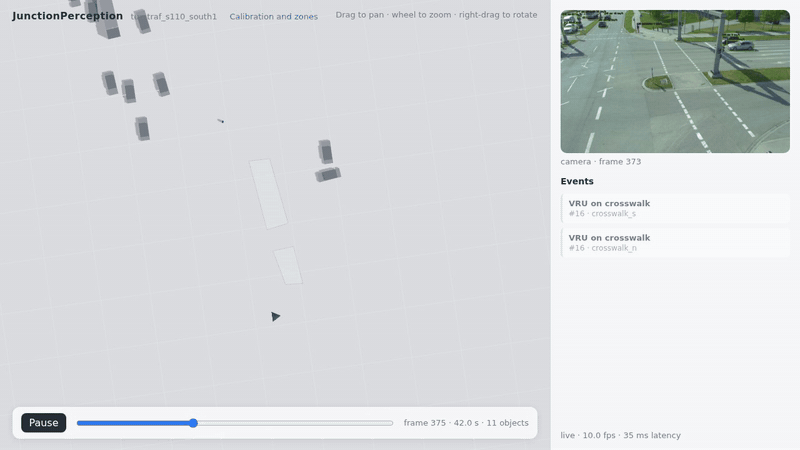

# Evaluation

The live pipeline is evaluated on the TUMTraf Intersection R02 benchmark: four sequences (S1–S3
by day, S4 at night in rain), each seen by the two south cameras of the S110 gantry, 4320 frames
in total. The camera videos run through detection, tracking and ground-plane localization exactly
as in the twin; the resulting world states are compared with the 3D labels of the south LiDAR.

```bash
JP_DATA_ROOT=<dataset root> JP_PYTHON=<python with matplotlib> scripts/run_benchmark.sh <run>
```

runs every sequence and camera for each bias-correction variant, evaluates them with `jp_eval`
(settings in `configs/evaluation.yaml`) and writes `outputs/<run>/eval/<variant>/report.md`,
`metrics.json`, a comparison `summary.md` and figures (`tools/plot_evaluation.py`).



*Live pipeline on TUMTraf Intersection R02, S3, south camera 1. Camera images: TUMTraf
Intersection dataset (Zimmer et al., ITSC 2023).*

## Method

- **Ground truth.** The bottom centre of each labelled 3D box, transformed into the scene's ground
  frame. A label counts if its box centre projects into the camera image; predictions matched to
  labels outside the image are ignored (neither true nor false positives). Label classes are
  mapped to twin classes by `configs/classes.yaml`.
- **Matching.** Per frame, Hungarian assignment on ground distance, class-agnostic, gated by the
  label's class group: 2.0 m for vehicles, 1.0 m for pedestrians and two-wheelers. Class errors
  are reported in a confusion matrix.
- **Displaced objects.** A label missed by the gate and a false positive within 5 m of each other
  are one object that was detected but placed beyond the gate. They are reported separately,
  with their error, so that localization failures are not mistaken for detection failures.
- **Motion.** Speed and direction of each label from its positions over a centred 1 s window.
  Heading errors are evaluated for labelled vehicles moving at 1 m/s or more.
- **Tracking.** CLEAR MOT (MOTA, identity switches) and IDF1 over the matched frames.
- **Conflicts.** A labelled vehicle–VRU pair is in conflict when the smallest gap between the
  vehicle footprint and the VRU within 3 s is below 1 m while it closes at 0.3 m/s or more (the
  rule of the live event detector, applied to the labels).

Position errors are given as mean / median / P90 (m); heading and speed errors as median / P90.

## Results

Bias correction (all sequences, both cameras):

| Contact-to-centre correction | Precision | Recall | Position error (m) | Heading error (deg) | Speed error (m/s) | MOTA | IDF1 |
|---|---|---|---|---|---|---|---|
| box fit (default) | 0.444 | 0.546 | 0.82 / 0.67 / 1.73 | 2.4 / 10.7 | 0.06 / 1.00 | −0.140 | 0.459 |
| ray offset | 0.424 | 0.521 | 0.91 / 0.76 / 1.75 | 2.1 / 10.5 | 0.06 / 1.03 | −0.189 | 0.433 |
| none (box bottom centre) | 0.370 | 0.452 | 0.89 / 0.78 / 1.69 | 1.7 / 10.5 | 0.10 / 1.24 | −0.320 | 0.382 |

Day and night (box fit):

| Condition | Labels | Precision | Recall | Position error (m) | Speed error (m/s) | IDF1 |
|---|---|---|---|---|---|---|
| day (S1–S3) | 23496 | 0.450 | 0.643 | 0.79 / 0.62 / 1.71 | 0.05 / 0.98 | 0.495 |
| night, rain (S4) | 5683 | 0.361 | 0.144 | 1.33 / 1.30 / 1.80 | 0.30 / 1.12 | 0.205 |

Localization beyond the gate (box fit):

| Condition | Displaced objects | Their error (m) | Recall within 5 m | Precision within 5 m |
|---|---|---|---|---|
| all | 4667 | 2.87 / 2.73 / 3.99 | 0.706 | 0.574 |
| day | 3923 | 2.76 / 2.67 / 3.87 | 0.810 | 0.566 |
| night | 744 | 3.46 / 3.52 / 4.43 | 0.275 | 0.688 |

Distance from the camera (box fit, all sequences):

| Range (m) | Labels | Recall | Position error (m) |
|---|---|---|---|
| 0–20 | 1457 | 0.610 | 0.85 / 0.80 / 1.58 |
| 20–40 | 13232 | 0.779 | 0.77 / 0.58 / 1.73 |
| 40–60 | 10886 | 0.377 | 0.89 / 0.89 / 1.68 |
| 60–80 | 3232 | 0.182 | 1.17 / 1.03 / 1.82 |
| 80–120 | 370 | 0.100 | 1.25 / 1.24 / 1.90 |

Classes (box fit, recall by label class, precision by predicted class):

| Class | Labels | Recall | Precision | Position error (m) |
|---|---|---|---|---|
| car | 15922 | 0.745 | 0.460 | 0.83 / 0.64 / 1.74 |
| pedestrian | 1822 | 0.692 | 0.373 | 0.46 / 0.47 / 0.73 |
| bicycle | 329 | 0.380 | 0.278 | 0.52 / 0.51 / 0.91 |
| motorcycle | 586 | 0.287 | 0.432 | 0.81 / 0.94 / 0.99 |
| van | 3421 | 0.379 | – | 0.80 / 0.74 / 1.48 |
| bus | 761 | 0.322 | 0.383 | 1.19 / 1.18 / 1.72 |
| truck | 3050 | 0.040 | 0.406 | 1.09 / 0.91 / 1.81 |
| trailer | 3200 | 0.256 | – | 1.22 / 1.30 / 1.84 |
| emergency vehicle | 88 | 0.420 | – | 1.67 / 1.69 / 1.91 |

The COCO-pretrained detector has no van, trailer or emergency-vehicle class: matched vans are
predicted as cars (1188) or trucks (101), trailers mostly as trucks (728).

Conflicts: the labels contain no vehicle–VRU conflict (the smallest gap between any visible
labelled vehicle and VRU is 1.53 m), and the system reports none.

<p>
  
  
</p>

## Interpretation

- **Bias correction.** Fitting a class-sized box to the detection lowers the median position error
  from 0.78 m to 0.67 m and raises recall from 0.45 to 0.55, because fewer objects fall outside the
  matching gate (7588 → 4667 displaced). The ray offset lies in between.
- **Distance.** Recall drops beyond 40 m: objects get small in the image, and their ground position
  degrades with the square of the range along the viewing ray. The median error of matched objects
  rises only slowly with range because objects with larger errors leave the gate; the displaced
  objects (median 2.7 m) are the rest of that distribution.
- **Night and rain.** Recall falls from 0.64 to 0.14: the detector, trained on COCO, finds far
  fewer road users in the dark, wet images. Those it finds are localized about twice as coarsely.
- **Long vehicles.** Trucks and trailers are labelled as separate boxes; the detector sees one
  vehicle, whose fitted box lies between both labels, so most of them are missed by the 2 m gate
  (truck recall 0.04).
- **Precision.** More than half of all predictions match no visible south-LiDAR label within 2 m.
  Within 5 m precision is 0.57; the remainder includes distant vehicles placed more than 5 m off
  and road users the south LiDAR did not label. With the merged south and north labels
  (`jp_eval --labels merged`) precision is 0.482 and MOTA −0.042. MOTA is negative because every
  unmatched prediction counts as a false positive.
- **Motion.** Speed is accurate (median error 0.06 m/s, P90 1.0 m/s); heading of moving vehicles
  has a median error of 2.4°.
