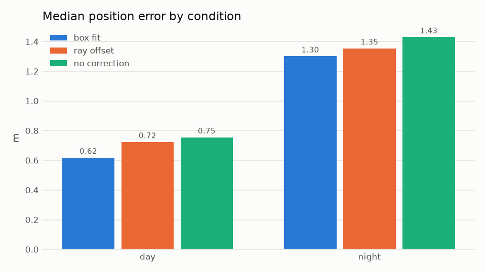
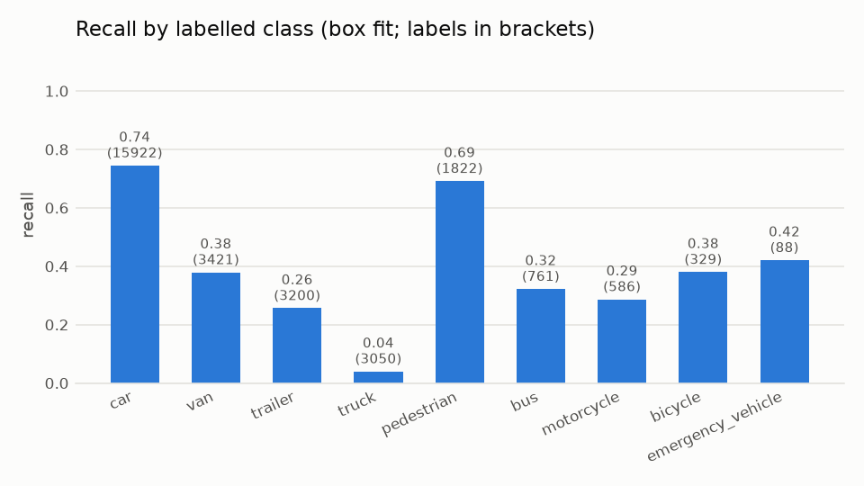

# Evaluation

The live pipeline is evaluated on the TUMTraf Intersection R02 benchmark: four sequences (S1–S3
by day, S4 at night in rain), each seen by the two south cameras of the S110 gantry, 4320 frames
in total. The camera videos run through detection, tracking and ground-plane localization exactly
as in the twin; the resulting world states are compared with the 3D labels of the south LiDAR.

```bash
JP_DATA_ROOT=<dataset root> JP_PYTHON=<python with matplotlib> scripts/run_benchmark.sh <run>
```

runs every sequence and camera for each bias-correction variant, evaluates them with `jp_eval`
(settings in `configs/evaluation.yaml`) and writes `outputs/<run>/eval/<variant>/report.md`,
`metrics.json`, a comparison `summary.md` and figures (`tools/plot_evaluation.py`).

## Method

- **Ground truth.** The bottom centre of each labelled 3D box, transformed into the scene's ground
  frame. A label counts if its box centre projects into the camera image; predictions matched to
  labels outside the image are ignored (neither true nor false positives). Label classes are
  mapped to twin classes by `configs/classes.yaml`.
- **Matching.** Per frame, Hungarian assignment on ground distance, class-agnostic, gated by the
  label's class group: 2.0 m for vehicles, 1.0 m for pedestrians and two-wheelers. Class errors
  are reported in a confusion matrix.
- **Displaced objects.** A label missed by the gate and a false positive within 5 m of each other
  are one object that was detected but placed beyond the gate. They are reported separately,
  with their error, so that localization failures are not mistaken for detection failures.
- **Motion.** Speed and direction of each label from its positions over a centred 1 s window.
  Heading errors are evaluated for labelled vehicles moving at 1 m/s or more.
- **Tracking.** CLEAR MOT (MOTA, identity switches) and IDF1 over the matched frames.

Position errors are given as mean / median / P90 (m); heading and speed errors as median / P90.

## Results

Bias correction (all sequences, both cameras):

| Contact-to-centre correction | Precision | Recall | Position error (m) | Heading error (deg) | Speed error (m/s) | MOTA | IDF1 |
|---|---|---|---|---|---|---|---|
| box fit (default) | 0.444 | 0.546 | 0.82 / 0.67 / 1.73 | 2.4 / 10.7 | 0.06 / 1.00 | −0.140 | 0.459 |
| ray offset | 0.424 | 0.521 | 0.91 / 0.76 / 1.75 | 2.1 / 10.5 | 0.06 / 1.03 | −0.189 | 0.433 |
| none (box bottom centre) | 0.370 | 0.452 | 0.89 / 0.78 / 1.69 | 1.7 / 10.5 | 0.10 / 1.24 | −0.320 | 0.382 |

Day and night (box fit):

| Condition | Labels | Precision | Recall | Position error (m) | Speed error (m/s) | IDF1 |
|---|---|---|---|---|---|---|
| day (S1–S3) | 23496 | 0.450 | 0.643 | 0.79 / 0.62 / 1.71 | 0.05 / 0.98 | 0.495 |
| night, rain (S4) | 5683 | 0.361 | 0.144 | 1.33 / 1.30 / 1.80 | 0.30 / 1.12 | 0.205 |

Localization beyond the gate (box fit):

| Condition | Displaced objects | Their error (m) | Recall within 5 m | Precision within 5 m |
|---|---|---|---|---|
| all | 4667 | 2.87 / 2.73 / 3.99 | 0.706 | 0.574 |
| day | 3923 | 2.76 / 2.67 / 3.87 | 0.810 | 0.566 |
| night | 744 | 3.46 / 3.52 / 4.43 | 0.275 | 0.688 |

Distance from the camera (box fit, all sequences):

| Range (m) | Labels | Recall | Position error (m) |
|---|---|---|---|
| 0–20 | 1457 | 0.610 | 0.85 / 0.80 / 1.58 |
| 20–40 | 13232 | 0.779 | 0.77 / 0.58 / 1.73 |
| 40–60 | 10886 | 0.377 | 0.89 / 0.89 / 1.68 |
| 60–80 | 3232 | 0.182 | 1.17 / 1.03 / 1.82 |
| 80–120 | 370 | 0.100 | 1.25 / 1.24 / 1.90 |

Classes (box fit, recall by label class, precision by predicted class):

| Class | Labels | Recall | Precision | Position error (m) |
|---|---|---|---|---|
| car | 15922 | 0.745 | 0.460 | 0.83 / 0.64 / 1.74 |
| pedestrian | 1822 | 0.692 | 0.373 | 0.46 / 0.47 / 0.73 |
| bicycle | 329 | 0.380 | 0.278 | 0.52 / 0.51 / 0.91 |
| motorcycle | 586 | 0.287 | 0.432 | 0.81 / 0.94 / 0.99 |
| van | 3421 | 0.379 | – | 0.80 / 0.74 / 1.48 |
| bus | 761 | 0.322 | 0.383 | 1.19 / 1.18 / 1.72 |
| truck | 3050 | 0.040 | 0.406 | 1.09 / 0.91 / 1.81 |
| trailer | 3200 | 0.256 | – | 1.22 / 1.30 / 1.84 |
| emergency vehicle | 88 | 0.420 | – | 1.67 / 1.69 / 1.91 |

The COCO-pretrained detector has no van, trailer or emergency-vehicle class: matched vans are
predicted as cars (1188) or trucks (101), trailers mostly as trucks (728).

<p>
  
  
</p>

## Interpretation

- **Bias correction.** Fitting a class-sized box to the detection lowers the median position error
  from 0.78 m to 0.67 m and raises recall from 0.45 to 0.55, because fewer objects fall outside the
  matching gate (7588 → 4667 displaced). The ray offset lies in between.
- **Distance.** Recall drops beyond 40 m: objects get small in the image, and their ground position
  degrades with the square of the range along the viewing ray. The median error of matched objects
  rises only slowly with range because objects with larger errors leave the gate; the displaced
  objects (median 2.7 m) are the rest of that distribution.
- **Night and rain.** Recall falls from 0.64 to 0.14: the detector, trained on COCO, finds far
  fewer road users in the dark, wet images. Those it finds are localized about twice as coarsely.
- **Long vehicles.** Trucks and trailers are labelled as separate boxes; the detector sees one
  vehicle, whose fitted box lies between both labels, so most of them are missed by the 2 m gate
  (truck recall 0.04).
- **Precision.** More than half of all predictions match no visible south-LiDAR label within 2 m.
  Within 5 m precision is 0.57; the remainder includes distant vehicles placed more than 5 m off
  and road users the south LiDAR did not label. With the merged south and north labels
  (`jp_eval --labels merged`) precision is 0.482 and MOTA −0.042. MOTA is negative because every
  unmatched prediction counts as a false positive.
- **Motion.** Speed is accurate (median error 0.06 m/s, P90 1.0 m/s); heading of moving vehicles
  has a median error of 2.4°.

## Site world model (multi-camera)

`tools/eval_fusion.py` replays the camera observations of both south cameras of TUMTraf R02 s03
(`jp_run`, default `configs/pipeline.yaml`, YOLO26l at 1280 px, box fit; 2 × 1033 frames) on
their image capture times through `manager/world_model.py`, south1 moved into the south2 ground
frame, and matches every site state to the labels interpolated at its time (greedy, 2 m vehicles /
1 m VRUs). Baselines: the same model with `fuse_cameras: false` (both cameras' tracks, unfused)
and each camera alone. Run of 2026-11-04 on the refactor branch:

| | Road users (sum over states) | Matched | Position error median / P90 (m) | Global ID switches |
|---|---|---|---|---|
| fused (both cameras) | 37 459 | 14 074 | 0.81 / 1.69 | 48 |
| unfused (both cameras) | 54 011 | 18 830 | 0.81 / 1.70 | 81 |
| south1 alone | 10 795 | 4 180 | 1.03 / 1.75 | 9 |
| south2 alone | 16 217 | 5 414 | 0.56 / 1.55 | 8 |

Labels that both cameras matched at the same time (overlap; only 138 label instants, 3–4 road
users in s03, so a small sample):

| | Represented by exactly one road user | By two or more | Missed | Nearest road user, median / P90 (m) |
|---|---|---|---|---|
| fused | 86 % | 14 % | 0 % | 1.21 / 1.33 |
| unfused | 1 % | 99 % | 0 % | 0.75 / 0.84 (the better camera) |

Of the labels some camera track matched, the fused state represents 98.7 %.

Clock error: adding 300 ms to south2's timestamps lowers the matched road users from 14 074 to
12 081 (positions of the wrong instant fall outside the gate); configuring
`time_offset_ms: -300` for that camera restores the synchronized result exactly.

Reading:

- Fusion does what it is for: one road user per physical road user in the overlap (86 % vs 1 %),
  global IDs kept through camera hand-overs (48 vs 81 switches).
- It does **not** improve positions: in the overlap the fused position is worse than the better
  camera (1.21 m vs 0.75 m), because the two cameras disagree systematically (south1's median
  error is 1.03 m, south2's 0.56 m) while their reported covariances are similar (≈0.25 m² each,
  dominated by the floor). Inverse-covariance weighting then lands between them. Fixing this
  needs per-camera bias estimates or a joint calibration, not a different weighting rule.
- Precision is low everywhere (0.33–0.39) because many road users lie beyond the labelled range
  of the south LiDAR; it is the same for single cameras and is not a fusion effect.
- 14 % of overlap instants still show two road users, mostly at the start of a co-observation
  before `merge_after` steps or when the cameras disagree by more than the gate.

## Motion heading: travel gate and covered box bottoms (2026-11-05)

`jp_run` + `jp_eval` on S1–S4, both south cameras, `yolo26l_1280` (boxes only), box fit,
merged labels, `--ignore-unlabelled`. "Off" is `motion_heading.min_travel_m: 0` and
`occlusion.noise_scale: 1` (the previous behaviour); "on" the defaults (3 m, 5).

| | Off | Travel gate only | Occlusion only | On |
|---|---|---|---|---|
| Heading axis error, all vehicles (mean / median / P90, deg) | 9.0 / 3.8 / 17.7 | 4.4 / 3.1 / 9.2 | 6.2 / 3.7 / 13.6 | 5.3 / 3.4 / 11.0 |
| ... standing vehicles | 12.3 / 4.5 / 41.0 | 4.2 / 3.8 / 8.4 | 7.1 / 4.3 / 19.7 | 5.8 / 3.9 / 11.5 |
| Buses with the front correct | 0.68 | 1.00 | 1.00 | 1.00 |
| Matched vehicles with a heading | 0.66 | 0.61 | 0.64 | 0.60 |
| Moving labelled vehicles without a heading | 263 | 661 | 371 | 720 |
| Recall / precision | 0.518 / 0.694 | 0.516 / 0.691 | 0.513 / 0.688 | 0.513 / 0.689 |
| Bus recall / precision | 0.530 / 0.587 | 0.368 / 0.415 | 0.372 / 0.470 | 0.368 / 0.416 |
| IDF1 | 0.562 | 0.560 | 0.557 | 0.558 |

The wrong headings are gone (a standing bus on s03 south2 was 130° off from its first seconds),
at a cost: vehicles get a motion heading only after 3 m, and the standing s03 south2 bus, now
without a heading, is placed about 4 m from its label (bus matches on s03 south2 174 → 59). Its
wrong heading had put the box fit closer by chance; the box fit without a heading (best overlap
of 12 candidate orientations) places a partly covered long vehicle poorly. Not yet addressed.

### Tractor and trailer as one truck (`jp_eval --merge-trailers`)

TUMTraf labels a tractor (TRUCK) and its trailer (TRAILER) as two boxes; the camera detector sees
one vehicle whose fitted centre lies between them, so the 2 m gate misses it. With
`--merge-trailers` each tractor and the trailer behind it (gap ≤ `articulated.max_gap_m`, yaws
within `max_angle_deg`, `configs/evaluation.yaml`) are one truck label from the trailer's rear to
the tractor's front. Same world states as "On" above:

| | Labels as boxed | Tractor and trailer merged |
|---|---|---|
| Recall / precision | 0.513 / 0.688 | 0.557 / 0.701 |
| IDF1 | 0.557 | 0.586 |
| Truck recall (labels) | 0.043 (3169) | 0.264 (3295) |
| Trailer recall (labels) | 0.231 (4059) | 0.273 (1603, without a tractor in front) |

The detector finds trucks far more often than the separate labels suggested; the measure, not the
pipeline, changed.

Tried and dropped: summing the overlap of each candidate axis over a headingless vehicle's
uncovered frames (instead of the best axis per frame). On synthetic covered boxes it lowered the
mean centre error from 1.9 to 1.5 m with large scatter; on TUMTraf it changed nothing (bus recall
0.354 vs 0.368, the standing s03 south2 bus 56 vs 59 matches), so its error is not the axis choice.

## Float16 detector weights (2026-11-05)

`yolo26l_1280_fp16` is `yolo26l_1280` with float16 weights (`tools/export_yolo26.py --fp16`,
float32 input and output), on the ONNX Runtime CUDA provider. Same evaluation as above
(S1–S4, both south cameras, box fit, merged labels, `--ignore-unlabelled --merge-trailers`).

| | float32 | float16 |
|---|---|---|
| Recall / precision | 0.557 / 0.701 | 0.556 / 0.700 |
| Matched labels / false positives | 18 285 / 7 783 | 18 261 / 7 839 |
| Position error median / P90 (m) | 0.658 / 1.686 | 0.658 / 1.690 |
| IDF1 / ID switches | 0.586 / 269 | 0.584 / 270 |
| Moving heading error median (deg) | 2.29 | 2.27 |
| Largest per-class change of recall or precision | | 0.004 (pedestrian precision) |

Detector time per frame on the RTX 3080 Laptop GPU of the server, nothing else running
(`jp_run`, 400 frames of s03, 20 warm-up frames excluded, decoding excluded):

| | float32 | float16 |
|---|---|---|
| One camera: inference / throughput | 59 ms / 15.4 fps | 35 ms / 24.4 fps |
| Two cameras in parallel: inference / throughput each | 121 ms / 7.8 fps | 66 ms / 13.7 fps |

With float32 two 10 fps cameras fall behind, and the site model drops the slower one as stale
(`stale_after_s`); with float16 both keep up.

## The console's own calibration, in world coordinates (2026-11-05)

South2 on s03, the camera and recording of the site `tumtraf_s110_south2_s03`, run as the
console runs it: `configs/pipeline.yaml` (float16 detector), the site camera's calibration from
control points on the map (`cameras/south2/ground_homography.yaml`) and, unless stated, its
detection areas and lines (`jp_run --regions`). The labels are moved into the site's east-north-up
frame with `tools/tumtraf_site_frame.py`: TUMTraf publishes no geographic position of its frames,
so the rigid transform (yaw 165.3°, shift 18.1 / −3.6 m) is fitted to the 15 control points of
south2 through the dataset's homography. Its residuals, 0.85 m RMS and up to 1.44 m on the far
points, are the disagreement between the map and the dataset's geometry; they are part of every
position error below and set its floor. `jp_eval --labels merged --merge-trailers
--ignore-unlabelled`: a label counts if its box centre is in the image; predictions where nothing
is labelled are ignored. Gates 2 m (vehicles) and 1 m (VRUs); "within 5 m" also counts labels
whose prediction is 2–5 m away.

| | UI calibration, ROI | UI calibration, no ROI | Dataset calibration, ROI |
|---|---|---|---|
| Labels | 10 098 | 10 098 | 10 098 |
| Found within the gate (recall) | 0.400 | 0.449 | 0.504 |
| Found within 5 m | 0.701 | 0.877 | 0.701 |
| Position error of found labels, median / P90 (m) | 0.55 / 1.16 | 0.59 / 1.36 | 0.46 / 1.41 |
| Range bias, median (m, + farther) | +0.42 | | +0.25 |
| Heading error of moving vehicles, median / P90 (deg) | 2.3 / 7.6 | | 2.0 / 7.9 |
| BEV IoU / 3D IoU of vehicles with a heading, median | 0.60 / 0.55 | 0.57 / 0.53 | 0.59 / 0.56 |
| IDF1 / ID switches | 0.42 / 38 | | 0.54 / 75 |

Recall by distance from the camera (UI calibration, ROI / no ROI): 0–20 m 0.04 / 0.49, 20–40 m
0.70 / 0.73, 40–60 m 0.29 / 0.30, 60–80 m 0.03 / 0.03. By class (ROI): car 0.47, van 0.26,
truck (with trailer) 0.55, bus 0.02, pedestrian 0.50, motorcycle 0.45, bicycle 0.00; 3D IoU
median car 0.64, van 0.22, truck 0.07.

- Detection does not depend on the calibration: 70 % of the labels are found within 5 m with
  either. The UI calibration places more of them 2–5 m off (3 034 against 1 993), mostly beyond
  40 m, where the control points are sparse and the map residuals largest.
- The ROI leaves out 18 % of the labels, nearly all within 20 m of the gantry.
- The 3D IoU assumes both boxes stand on the ground: the twin has no vertical position, its height
  is the class height. Its footprint is the class size too (the box detector measures no size),
  so a merged tractor and trailer, far longer than the truck class, and vans, which the detector
  mostly calls cars, overlap little.
- One recording of one camera (1 033 frames, day): no night, no other sequence; thresholds of the
  tracker and the heading were tuned on S1–S4, which include it.

### South1 on s01 (cam1 of the same site)

Same procedure for south1 on s01 (282 frames, 28 s, day), the site camera `cam1`: its control
points align the labels with 0.49 m RMS (yaw 165.5°, shift 17.9 / −3.5 m). Nearly all labelled
vehicles stand (884 of 923 matched), so none gets a motion heading and no IoU can be computed.

| | UI calibration, ROI | UI calibration, no ROI | UI homography, camera model from it alone, ROI | Dataset calibration, ROI |
|---|---|---|---|---|
| Labels | 2 576 | 2 576 | 2 576 | 2 576 |
| Found within the gate (recall) | 0.396 | 0.657 | 0.502 | 0.500 |
| Found within 5 m | 0.512 | 0.839 | 0.512 | 0.512 |
| Position error, median / P90 (m) | 1.64 / 1.78 | 1.27 / 1.78 | 0.95 / 1.69 | 0.71 / 1.80 |
| Range bias, median (m) | +1.62 | | +0.87 | +0.70 |
| IDF1 | 0.52 | 0.66 | 0.65 | 0.65 |

Recall by distance, ROI / no ROI: 0–20 m 0.29 / 0.86, 20–40 m 0.65 / 0.66, 40–60 m 0.03 / 0.60,
60–80 m 0.00 / 0.73. Vans and trucks (with trailer) 0.00 with the ROI, 0.86 and 0.54 without.

- The cam1 detection area ends about 40 m from the gantry and leaves out the far lanes: two
  thirds of the labels it misses are outside it.
- Box fit never ran with these calibrations. A camera model built from control points kept the
  homography's arbitrary scale, so its third projected coordinate was no depth in metres, box
  fit rejected every fit as "behind the camera" and the localizer fell back to the ray offset
  (identical output). The ray offset moves cam1's vehicles 2.25 m from the box bottom, box fit
  with the dataset's model 1.0 m: hence the 1.6 m. The ground mappings themselves differ by 0.40 m
  (median) where cam1's vehicles are, 0.56 m for south2's.

### Box fit with control-point calibrations (`metric_projection`)

Camera models are now scaled to metres when built and when loaded, so box fit runs with site
calibrations. Same runs as above (ROI, labels in the site frame):

| | Ray offset (before) | Box fit, entered camera position | Box fit, model from the homography alone | Box fit, dataset's camera position | Dataset calibration |
|---|---|---|---|---|---|
| cam1 s01: recall / median error (m) | 0.396 / 1.64 | 0.483 / 1.09 | 0.483 / 1.12 | | 0.500 / 0.71 |
| south2 s03: recall / median error (m) | 0.400 / 0.55 | 0.367 / 0.77 | 0.387 / 0.65 | 0.399 / 0.65 | 0.504 / 0.46 |
| south2 s03: 3D IoU, median | 0.55 | 0.38 | 0.45 | 0.45 | 0.56 |

Box fit is only as good as the camera model under it: on cam1 it removes most of the error, on
south2, whose entered camera position is 5 m off and whose homography disagrees more with the
dataset, it is worse than the ray offset even with the dataset's camera position.

### A camera pose locked as "entered"

The calibration page took the camera position and height in the file as set by hand and saved
them back as such, although the file always holds them: south2 kept the dataset's height from
the file the site was created from and a position placed 5 m off on the map, cam1 the estimate of
an older point set. The file now records which values were entered; saved again with their own
control points and nothing entered (estimates: cam1 19.66 / 10.86 m, 8.69 m high; south2
17.77 / −5.33 m, 9.63 m high, against the dataset's 17.32 / −6.18 m, 8.71 m):

| | Before both fixes | Box fit, pose re-estimated | Dataset calibration |
|---|---|---|---|
| cam1 s01: recall / median error (m) | 0.396 / 1.64 | 0.502 / 0.95 | 0.500 / 0.71 |
| south2 s03: recall / median error (m) | 0.400 / 0.55 | 0.384 / 0.57 | 0.504 / 0.46 |
| south2 s03: 3D IoU, median | 0.55 | 0.49 | 0.56 |
| Both: recall over 12 674 labels | 0.399 | 0.408 | 0.503 |

cam1 now matches the dataset calibration's recall. south2 loses 1.6 points of recall and 0.06 of
3D IoU against the ray offset: its control points estimate the camera 0.9 m too high, and box
fit needs a better camera model than the ray offset does.
